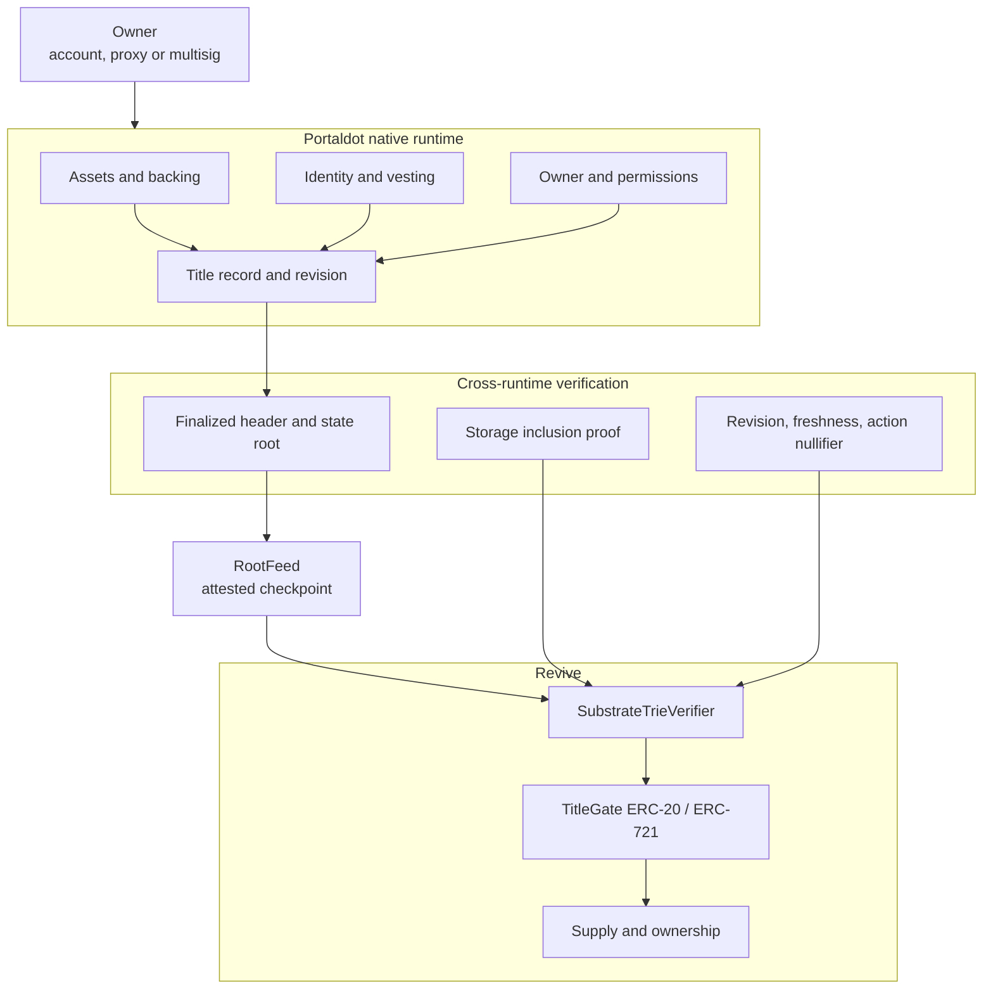

<div align="center">

# LEMO

### One asset. Two rooms. One title both rooms must obey.

[](https://lemo-ebon.vercel.app)
[](#live-status)
[](#tests)
[](#tests)
[](#tests)

[](#live-status)
[](#run-it-in-one-command)
[](#verify-every-claim-in-one-command)
[](#whats-real-vs-pending--the-honesty-table)

[Live](https://lemo-ebon.vercel.app) · [Console](https://lemo-ebon.vercel.app/console) · [Flow](https://lemo-ebon.vercel.app/console/flow) · [Protocol](#the-story) · [Prior art](#how-projects-with-the-same-idea-finish) · [Evidence](docs/EVIDENCE.md) · [Audit](docs/AUDIT.md) · [Demo script](docs/demo-script.md)

</div>

Portaldot has two rooms. In the native room an asset has an owner, a backing balance, an identity, vesting and permissions. In the Revive room a token moves through Solidity. The rooms settle under the same finality, but they do not share storage.

A token can move in the second room while the first room has already forgotten why it was allowed to exist.

LEMO is the title both rooms have to agree on. The native record is the legal room. The Revive token is the market room. Neither room gets to act alone: the token asks for a finalized proof of the native title before it moves, and the native side refuses to release backing while a representation is still alive.

The proof is not a server call and not a bridge message. It is a storage proof against a finalized state root, verified by the contract that is about to change state.

## Live status

| Surface | State | Evidence |
|---|---|---|
| Marketing site and console | **Live** | [lemo-ebon.vercel.app](https://lemo-ebon.vercel.app) |
| Transaction console | **Live, gate wired** | [/console/flow](https://lemo-ebon.vercel.app/console/flow) |
| Blake2b adapter | **Live on Portaldot V3** | `0x15ae34fa8fd933d6d4e1cf9a772b305f0abc7e22` |
| Trie verifier | **Live on Portaldot V3** | `0xe5ca668667d3e2c8a0272ee4e446d6aa88a86bac` |
| Root feed | **Live, root attested** | `0xc1c95be2f38f865438f684d269f340f5c505d5c0`; root `0x19ff…8b80` at #294515 |
| ERC-20 gate | **Live on Portaldot V3** | `0xfbefe3cbf0785b3d08814eb02a348c9ca296741f` |
| Parallel two-contract deployment | **Live** | `0xc887…88bB` registry, `0x61c3…8ff7` token |
| Native title registry | **Pallet, not in the runtime** | `pallets/lemo-title`, 10 tests |
| Gate mint/transfer | **Wired, not proven end to end** | placeholder commitment; no native title proof |
| Contracts | **89 Foundry tests passing** | `forge test` |
| Proof service | **1,077 tests passing** | `server/` |
| Security audit | **Self-audit; criticals and H-05 fixed** | [docs/AUDIT.md](docs/AUDIT.md); H-06/H-07 open |

The honest line: the site, the proof surface and four support contracts are live. The gate's title is a deployment placeholder, so this is not a live asset system yet.

## The 20-second pitch

Every wrapped asset answers "where is the backing?". LEMO asks a harder question: **does the token still have the right to exist?**

The EVM gate checks a finalized native title proof before a mint, transfer or burn. The native side refuses to release backing while a representation is outstanding. The same revisioned title has to survive in both rooms, and every failed check reverts before a balance moves.

## How Portaldot is load-bearing

Short version: **Portaldot is not a host; it is one of the two ledgers under test.**

1. **Native state.** The title record is meant to live in the native runtime, with backing, owner, identity, vesting, permissions and a monotonic revision.
2. **Revive state.** The ERC-20 representation lives in Revive, with balances, supply and a proof check before every movement.
3. **tPOT.** The native wallet pays the storage deposit for the contracts; the EVM address is only a mapped account.
4. **State proofs.** `state_getReadProof` at a finalized block is the input the Solidity verifier walks.
5. **Finality.** Both rooms settle under the same validator set. The current root feed is a trusted checkpoint, not a light client; that boundary is named in the code and the audit.

## Table of contents

- [▶ Demo](#-demo)
- [Live status](#live-status)
- [The 20-second pitch](#the-20-second-pitch)
- [How Portaldot is load-bearing](#how-portaldot-is-load-bearing)
- [Run it in one command](#run-it-in-one-command)
- [Verify every claim in one command](#verify-every-claim-in-one-command)
- [What LEMO is NOT](#what-lemo-is-not)
- [The problem](#the-problem)
- [How projects with the same idea finish](#how-projects-with-the-same-idea-finish)
- [What I built](#what-i-built)
- [Architecture](#architecture)
- [The two rules, step by step](#the-two-rules-step-by-step)
- [Where the guarantee is enforced](#where-the-guarantee-is-enforced)
- [The live run](#the-live-run)
- [Live deployments and transactions](#live-deployments-and-transactions)
- [Engineering decisions and traps](#engineering-decisions-and-traps)
- [What's real vs pending — the honesty table](#whats-real-vs-pending--the-honesty-table)
- [Attack → test](#attack--test)
- [Limitations](#limitations)
- [Security](#security)
- [Tech stack](#tech-stack)
- [Project layout](#project-layout)
- [Full command reference](#full-command-reference)
- [How I'd deploy the rest](#how-id-deploy-the-rest)
- [Tests](#tests)

## ▶ Demo

The demo is website-only and runs at [lemo-ebon.vercel.app](https://lemo-ebon.vercel.app). The click-by-click script is [docs/demo-script.md](docs/demo-script.md). The owner records the video; this repository does not ship a fabricated one.

The live demo is read-only by design: it reads finalized heads, walks a real Substrate proof, shows `eth_getProof` refusing, verifies a storage key and inspects the four deployed contracts. It stops before Mint, because the gate's title commitment is a placeholder and no native title proof exists.

## Run it in one command

```bash
npm install && npm run dev
```

Open `http://localhost:3000` for the landing page and `/console/flow` for the transaction surface. The app reads the public Portaldot V3 endpoints through the same-origin `/api/rpc/*` proxy; no wallet is required for the read pages.

For the production build:

```bash
npm run build && npm run start
```

## Verify every claim in one command

```bash
npx tsc --noEmit
forge test
cd server && npm test
cd ../pallets/lemo-title && cargo test
```

The four commands above produce the numbers in the badges. The live chain reads are listed in [docs/EVIDENCE.md](docs/EVIDENCE.md) with the exact addresses, transactions and costs.

## What LEMO is NOT

- **Not a bridge.** No asset is locked on one chain and minted on another by a relayer. The verifier checks a proof against a root both sides already accept.
- **Not a wrapper.** The EVM token is not a claim on a custodian. It is a second face of the same title, gated by the native record.
- **Not a server authority.** The proof service carries bytes and verifies them; it cannot make a bad proof pass.
- **Not a live native asset system yet.** The native registry is a pallet outside the runtime, and the live gate has no real title to prove. The site says so.
- **Not audited.** [docs/AUDIT.md](docs/AUDIT.md) is a self-audit, not a third-party sign-off.

## The problem

Portaldot V3 has two ways to hold an asset and no shared contract storage between them.

- Native ownership rules do not automatically follow an ERC-20 or ERC-721 representation.
- Solidity applications see a token, not the identity, vesting or permissions behind it.
- Backing can leave while a representation still circulates.
- The usual fix is a synchronization service that becomes the authority.

Wrapping an asset moves it. It does not enforce the relationship between the original backing and its representation.

## How projects with the same idea finish

The full census, with primary sources, is [docs/competitive-research.md](docs/competitive-research.md). It is a sample of the field, not an exhaustive claim.

| Project | What shipped | How it closes the gap | What LEMO still lacks |
|---|---|---|---|
| Polkadot ERC-20 precompile | `pallet-assets` exposed as an ERC-20 address | Aliasing: one ledger, two interfaces | A deployed native title registry |
| Hydration | Frontier EVM inside the native runtime | One runtime, one state; strongest objection to LEMO's premise | The native half in the runtime |
| Moonbeam XC-20 | XCM-transferable ERC-20s | Wrapped representation plus XCM custody | A two-way proof instead of custody |
| Snowbridge | Polkadot↔Ethereum bridge | BEEFY/Beacon light clients, permissionless relayers, third-party audits | A light-client root source and external audit |
| Evmos `x/erc20` | Governance-registered Coin/ERC-20 pairs | Runtime-enforced pair registry | A native title, not just a pair |
| Polymesh | Compliance on every transfer | Runtime identity claims and rules | An EVM face |
| Centrifuge | ERC-20 shares with transfer hooks | ERC-1404-style memberlists and per-transfer checks | A native record outside the EVM runtime |
| ERC-3643 / Tokeny | Compliant-token stack | On-chain identity and compliance registries | A second runtime that verifies the first |
| tBTC | Bitcoin redemption with SPV proofs | One-way proof verification plus bonded signers | The mirror rule (native release blocked by outstanding EVM supply) |

What they all did that this repo has not:

1. Deployed the authoritative side. Their registry or light client is live; our native registry is still a pallet.
2. Closed the trust model. Snowbridge has light clients and named audits; our root source is one attester and our audit is a self-audit.
3. Shipped a stranger-runnable lifecycle. They have a live mint/transfer/redeem path with published transactions; our mint/transfer path cannot settle.
4. Published an external review. We have not.

LEMO's differentiator is still real: the unit of authorisation is a revisioned **title** — backing, owner, identity, vesting and permissions in one commitment — not a balance, and the invariant is meant to run both ways. The missing pieces are deployment and review, not the idea.

## What I built

- **Solidity verifier**: walks blake2b-256 Substrate trie nodes from a state root, decodes a 320-byte title record, and returns a typed status.
- **Title gates**: ERC-20 and ERC-721 variants that bind chain, title, token, operation, revision, root and commitment before any balance moves.
- **Root feeds**: a single-attester `RootFeed` and an M-of-N `ThresholdRootFeed`.
- **Unbond guard**: Rule 2 in Solidity, with a release recheck and one open request per title.
- **Native pallet**: `pallets/lemo-title`, with create, edit, representation, fail-closed liveness and unbond calls; 10 tests.
- **Proof service**: a Fastify service with typed RPC clients, trie verification, fixtures and 1,077 tests.
- **Console**: landing, overview, proof walk, key verifier, network checks and a real transaction surface.
- **Deployment tooling**: `revive.instantiateWithCode` from the native SS58 wallet, plus the Foundry path and cost measurement.

## Architecture



The arrows carry bytes, not calls. Each environment verifies a proof against a state it already trusts. A relayer can carry a proof; it cannot make a bad proof verify.

## The two rules, step by step

### Rule 1: the EVM gate checks the native title

1. Read `chain_getFinalizedHead` and the header at that hash.
2. Ask `state_getReadProof` for the title's storage key at that block.
3. Index every returned node by `blake2b_256(node)`.
4. Walk from the state root, consuming partial keys and branch nibbles.
5. Decode the 320-byte title record.
6. Recompute the commitment and compare it with the gate's title commitment.
7. Check the chain, title id, token address, operation, revision and current feed root.
8. Consume the action nullifier and only then move the balance.

### Rule 2: the native side checks the representation

`UnbondGuard.requestUnbond` refuses while `representationOutstanding()` is true, spends the proof's nullifier and records one open request per title. `completeUnbond` re-checks `representationOutstanding()` at release time, so a burn → request → re-mint sequence cannot release backing twice.

The native pallet implements the same rule as `request_unbond` with a `RepresentationLive` check that must be an explicit `Some(false)`; an unset flag is fail-closed. The pallet is source and tests, not a runtime deployment.

## Where the guarantee is enforced

| Guarantee | Enforced by |
|---|---|
| No EVM state change without a current native proof | `TitleGateBase._gate`, `SubstrateTrieVerifier.verifyTitle` |
| A proof cannot be replayed for the same action | action-scoped nullifier in `TitleGateBase` |
| A mint cannot exceed the supply cap | `TitleGateERC20.maxSupply` |
| A mint cannot be front-run to another recipient | `mint` binding to `record.owner` |
| A burn cannot destroy another holder's balance | `burn` caller check |
| Native release is blocked while a representation exists | `UnbondGuard.requestUnbond` and `completeUnbond` |
| Unknown liveness cannot authorise an unbond | `RepresentationLive` `OptionQuery` + `Some(false)` |
| The node cannot invent the value | the verifier returns `ABSENT`, `INCOMPLETE`, `INVALID`, `ROOT_MISMATCH` or `VALUE_MISMATCH` |

## The live run

| Surface | Works today |
|---|---|
| Read finalized native head, Revive head, state root | Yes, through the same-origin proxy |
| Walk a real Substrate storage proof in the browser | Yes, against a live captured proof |
| Show the EVM endpoint refusing `eth_getProof` | Yes, verbatim |
| Inspect the four deployed addresses and code | Yes |
| Connect an EVM or Substrate wallet | Yes, runtime discovery, no invented provider |
| Simulate a mint or transfer | Yes, `eth_call` from the signer |
| Settle a mint or transfer | **No** — placeholder commitment, no native title proof |
| Create a native title, clear identity, unbond backing | **No** — pallet not in the runtime |

## Live deployments and transactions

| Contract | Address | Transaction |
|---|---|---|
| `ReviveBlake2b256` | `0x15ae34fa8fd933d6d4e1cf9a772b305f0abc7e22` | `0x49d848…93c8d` |
| `RootFeed` | `0xc1c95be2f38f865438f684d269f340f5c505d5c0` | `0x4cc848…328b` |
| `SubstrateTrieVerifier` | `0xe5ca668667d3e2c8a0272ee4e446d6aa88a86bac` | `0x2e85d6…323c` |
| `TitleGateERC20` | `0xfbefe3cbf0785b3d08814eb02a348c9ca296741f` | `0x3117d6…4f07` |

The root feed is live at `currentRoot = 0x19ff4a2de31211f1fc6d508ba7ddbd23477ed289bc804dc826f0fa2b99898b80`, attested at finalized block 294515. Full costs and read-back values are in [docs/EVIDENCE.md](docs/EVIDENCE.md).

The parallel two-contract deployment in [contracts/DEPLOYMENTS.md](contracts/DEPLOYMENTS.md) is a separate, smaller implementation. It is live, but it is not the gate used by `/console/flow`.

## Engineering decisions and traps

1. **Storage is the cost.** Portaldot charges `0.06 tPOT` per code byte plus a 30% code-hash lockup. A 779-byte hasher costs 71.78 tPOT; the full four-contract suite was about 1,378 tPOT. Measure before broadcasting.
2. **tPOT is native.** An EVM address holds its tPOT through the `H160 ++ 0xEE*12` mapping. Funding the `0x` address directly does nothing.
3. **EVM constructor arguments belong in the code blob.** `revive.instantiateWithCode` rejects separate `data` with `EvmConstructorNonEmptyData`.
4. **The weight limit must fit the block.** Passing `maxEthExtrinsicWeight` returns `Transaction would exhaust the block limits`; `1.5e12` refTime works.
5. **The public RPC drops bursts.** Browser calls went through CORS failures on 503. The app now uses same-origin `/api/rpc/*` proxies with a retry and a short cache.
6. **The Vercel build typechecks the repo.** The merged `backend/` package uses `.ts` imports; the root `tsconfig` excludes it so `next build` stays green.
7. **The chart needs a height before it can measure.** `ResponsiveContainer` now has `minHeight={240}`.

## What's real vs pending — the honesty table

| Claim | Status | Evidence |
|---|---|---|
| Four support contracts deployed | **Yes** | addresses above, `docs/EVIDENCE.md` |
| Root feed has an attested finalized root | **Yes** | `currentRoot` at block 294515 |
| Solidity verifier passes a real Substrate proof | **Yes** | `test/SubstrateTrieVerifier.t.sol` |
| Browser verifier passes a real Substrate proof | **Yes** | `server/test/fixtures/portaldot-v3.json` |
| Gate binds a real native title | **No** | placeholder commitment |
| Mint and transfer settle on testnet | **No** | no native title proof |
| Native registry is live | **No** | pallet not in the runtime |
| Rule 2 is enforced on native | **No** | pallet not in the runtime |
| Independent root source | **No** | single-attester `RootFeed` |
| External audit | **No** | self-audit only |

## Attack → test

| Attack | Test that refuses it |
|---|---|
| Mint without backing | `test_01_MintWithoutBacking` |
| Mint with no proof | `test_02_MintWithNoProof` |
| Burn another holder's balance | `test_BurnByAnOutsiderIsRefusedBeforeTheProof` |
| Replay the same action | `test_06_ProofDoubleSpend` |
| Replay after a new root | action-scoped nullifier + `test_RevertOnReplayedProof` |
| Use a mint proof to burn | `test_05_BurnWithAMintProof` |
| Burn proof to mint | `test_08_BurnProofCannotMint` |
| Stale root | `test_15_StaleRoot` |
| Wrong token contract | `test_16_WrongTokenBinding` |
| Wrong revision | `test_18_RevisionClaimDoesNotMatchTheRecord` |
| Cleared identity | `test_19_ClearedIdentity` |
| Unbond while supply is outstanding | `test_12_UnbondWhileRepresentationOutstanding` |
| Complete an unbond after a re-mint | `test_21_CompletedUnbondRechecksRepresentation` |
| Two open unbonds for one title | `test_22_OnlyOneOpenUnbondPerTitle` |
| Zero-recipient mint | `test_MintCannotExceedTheCommittedSupplyCap` + ERC-721 zero check |
| Unknown native liveness | `unbond_is_refused_while_representation_state_is_unknown` |

## Limitations

- The native registry is a pallet, not a runtime. The public V3 node does not expose the contracts API, so the native half cannot run here.
- The live gate's commitment is a placeholder. It is a real contract with a real verifier, but there is no real title to prove.
- The root feed is one attester. `ThresholdRootFeed` exists and is tested but is not deployed.
- The pallet's SCALE record is 260 bytes, while the EVM decoder expects 320 with a 160-bit owner. H-06 is open and fail-closed.
- A distinct action at the same revision gets a distinct nullifier; the audit's H-01 notes that a true per-revision spend counter is still the stronger design.
- No external audit. The self-audit is in [docs/AUDIT.md](docs/AUDIT.md).

## Security

- [docs/AUDIT.md](docs/AUDIT.md): 28 findings, criticals and H-05 remediated, H-06/H-07 open.
- Critical fixes: supply cap, recipient binding, burn caller restriction, action-scoped nullifier, unbond release recheck, one open request per title, zero-recipient refusal, ERC-165.
- The proof service never accepts a caller-supplied state root.
- The public RPC proxy uses a method allowlist and does not expose wallet-signing methods.

## Tech stack

- Next.js 16 App Router, React 19, Tailwind v4, TypeScript
- Foundry, Solidity 0.8.26, solc via `forge`
- Substrate FRAME pallet, Rust
- Fastify proof service, TypeScript
- Portaldot V3 Revive EVM, chain id 420420777
- Vercel production deployment

## Project layout

```text
app/                 landing, console routes, /api/rpc proxy
components/          marketing, console, wallet, flow panels
lib/                 chain reads, proofs, wallet, flow codecs
contracts/           Solidity contracts and Foundry tests
pallets/lemo-title/  native title registry pallet
server/              Fastify proof service
backend/             parallel proof service for the two-contract deployment
docs/                evidence, audit, deployment, demo, competitive research
test/                Foundry tests and harnesses
script/              Foundry deployment script
scripts/             native deploy and root attestation
```

## Full command reference

```bash
# site
npm install
npm run dev
npm run build
npm run start

# contracts
forge build
forge test

# native pallet
cd pallets/lemo-title && cargo test

# proof service
cd server && npm install && npm test

# native deployment (native tPOT wallet)
PORTALDOT_MNEMONIC=... STORAGE_LIMIT_TPOT=650 \
  node scripts/native-deploy.mjs TitleGateERC20 <constructorArgsHex>

# root attestation
ATTESTER_PRIVATE_KEY=... FEED_ADDRESS=0xc1c9…d5c0 \
  EVM_RPC=https://test-evm-rpc-v3.portaldot.dev ./scripts/attest-root.sh
```

## How I'd deploy the rest

1. Include `pallets/lemo-title` in a Portaldot runtime upgrade and expose a runtime API for the fixed-width title record.
2. Create a title with real backing and identity; publish its revision.
3. Attest the finalized root and set the gate's title commitment to that record.
4. Move the gate from the single-attester `RootFeed` to a deployed `ThresholdRootFeed` with independent attesters.
5. Get an external audit before calling the asset system production-ready.

## Tests

```text
forge test                         89 passed, 0 failed
cargo test (pallet)                10 passed, 0 failed
server npm test                 1,077 passed, 0 failed
```

The proof tests include a live-captured Portaldot fixture, tampered root, tampered child, wrong key, truncation, false absence and a 1,019-case stress suite. The gate tests cover stale root, old revision, unbound backing, cleared identity, wrong contract, wrong chain, wrong operation, replay, pause, supply cap, recipient binding and an interrupted unbond.

---

Four support contracts are live on Portaldot V3. The native registry, the real title proof and the external audit are still missing. The site says that on every page.
