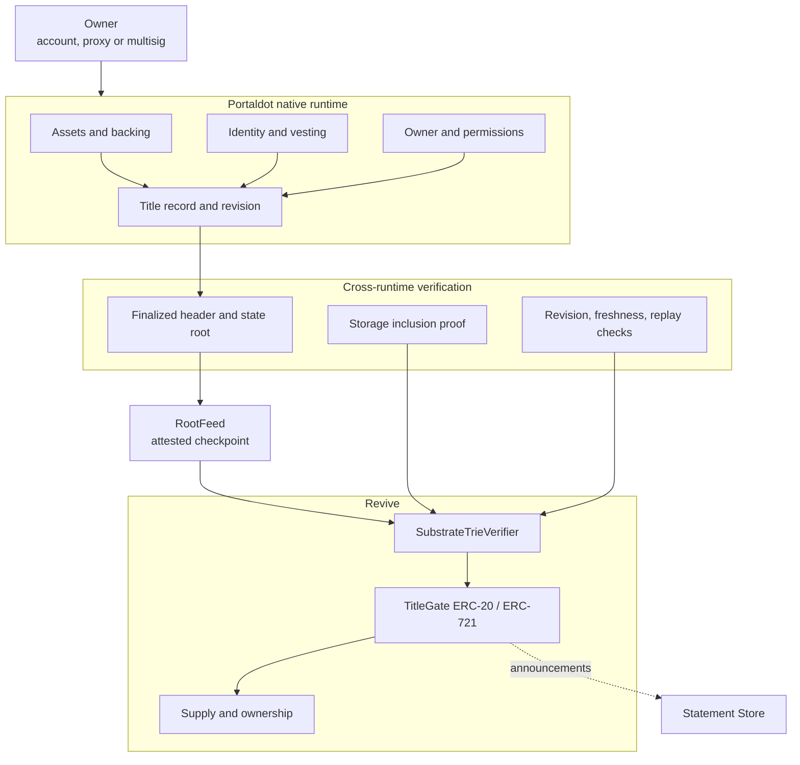

<div align="center">

# LEMO

**One title. Two faces. A proof between them.**

[](#what-is-real-and-what-is-not)


[Protocol](#the-protocol) · [Rules](#the-two-rules) · [Contracts](#contracts) · [Console](#the-console) · [Evidence](docs/EVIDENCE.md) · [Deck](deck/lemo-deck.pdf) · [Demo script](docs/demo-script.md)

</div>

## Current state

Portaldot V3 ships **Revive**, its EVM environment, today. The native runtime already holds assets, identity, vesting and proxy or multisig ownership records. The **WASM contract module is listed for V3.0 and is not live or documented**; ink! to Solidity cross calls are awaiting confirmation.

LEMO is the design that gives an asset one revisioned title across the native record and a Revive representation, with a finalized state proof required in both directions. The EVM side is implemented here. The native registry is implemented as a FRAME pallet in `pallets/lemo-title`; the remaining step is a runtime upgrade.

| What exists in this repository | State |
|---|---|
| Live console reading both Portaldot V3 endpoints over JSON-RPC | Working |
| Browser storage-proof verifier for the native state trie | Working, checked against a live proof |
| Fastify proof service with typed RPC clients and offline fixtures | Working, 1,077 tests |
| Solidity Substrate trie verifier | Working, checked against the same live proof |
| ERC-20 and ERC-721 transfer gates with revision, root and replay checks | Working, 86 Foundry tests |
| Title commitment, RootFeed, threshold root feed and unbond guard | Working, 86 Foundry tests; 9 pallet tests |
| Native title registry (`pallets/lemo-title`) | Working in tests; runtime inclusion not deployed |
| Deployment and tPOT funding | See [docs/DEPLOYMENT.md](docs/DEPLOYMENT.md) |
| Hasher and root feed on Portaldot V3 | Deployed: `0x15ae…7e22`, `0xc1c9…d5c0`; see [docs/EVIDENCE.md](docs/EVIDENCE.md) |
| Gate and verifier on the testnet | Not deployed; ~675 + ~600 tPOT |
| Transaction console at `/console/flow` | Working; waits for `NEXT_PUBLIC_LEMO_GATE` and `_VERIFIER` |
| Security audit | Self-audit in [docs/AUDIT.md](docs/AUDIT.md); critical findings fixed |

The honest version: this is a tested protocol implementation and a live read-only console, not a live asset system. Read [docs/EVIDENCE.md](docs/EVIDENCE.md) for the artifact behind every claim.

## The problem

Portaldot V3 has two ways to hold an asset and no shared contract storage between them.

- Native ownership rules do not automatically follow an ERC-20 or ERC-721 representation.
- Solidity applications see a token, not the identity or vesting conditions behind it.
- Backing can leave while a representation still circulates.
- The usual fix is a synchronization service that becomes the authority.

Wrapping an asset moves it. It does not enforce the relationship between the original backing and its representation.

## The protocol

LEMO creates one title identifier with two independently maintained faces.

### The native record

The native runtime holds backing, owner, identity status, vesting conditions, account permissions and a revision. This is the authoritative record for whether the asset still qualifies for its title.

Today these records live in runtime storage. The WASM contract module that would let a contract enforce title logic on this side is listed for V3.0, not launched.

### The Revive representation

The EVM face exposes a familiar ERC-20 or ERC-721. It carries the same title identifier, its current supply or ownership, and the last native revision it accepted.

Existing Solidity applications can interact with the token through familiar interfaces. The token does not replace the native title. It represents an asset governed by that title.

```text
NATIVE RECORD                         REVIVE REPRESENTATION
backing                               ERC-20 / ERC-721
owner                                 supply / holders
identity                              transfers
vesting                               Solidity applications
permissions
revision
        \                              /
         finalized state proofs
          \                          /
           one title identifier
```

## The two rules

### Rule 1: the EVM gate checks the native title

Before an ERC-20 or ERC-721 transfer, the EVM face verifies a finalized native title proof. The proof must establish that the title exists, backing is bound, identity and vesting conditions hold, the revision is current, and the proof is fresh.

If identity is cleared, backing is unbound or the proof is stale, the transfer reverts.

This gate is implemented in Solidity and tested against a live native proof.

### Rule 2: the native gate checks the representation

Before native unbonding, the native side must verify that the EVM representation is fully retired: ERC-20 supply is zero, or every ERC-721 representation has been burned. The proof must belong to the correct title, contract and revision, and must not be replayable.

This rule is implemented as native guard logic in `contracts/UnbondGuard.sol` and tested locally. Enforcing it on Portaldot needs the WASM contract module. It cannot be claimed as live.

## Architecture



The proof exchange is not a contract-to-contract call. Each environment receives proof data and verifies it against an authenticated finalized state. The arrows carry bytes, not calls.

## The title

Every LEMO asset has one title identifier. The title commits to the relationship between its faces.

```text
LEMO_TITLE {
  title_id            0x7f3a...c19e
  chain_id            420420777
  native_asset        POT
  backing_amount      100.00
  native_owner        5Grw...utQY
  identity_hash       0x...
  vesting_hash        0x...
  permissions_hash    0x...
  evm_contract        0xA19c...B3C5
  revision            07
}
```

The hash is domain separated and versioned. Changing an important title property increments the revision. Proofs from previous revisions cannot authorize a transfer.

`LEMO_TITLE` is a commitment, not proof of validity. Each runtime must verify the underlying state.

## Lifecycle

### 1. Create

The owner creates a native title and locks backing. Ownership, identity conditions and vesting rules are recorded in the native runtime.

### 2. Represent

The EVM representation is created against the same title identifier, but only after the native backing is verified.

### 3. Transfer

An owner transfers the representation. The token calls the verifier before changing state. A finalized native proof at the current revision is required, and the proof is consumed so it cannot be replayed.

### 4. Update

If identity, backing or ownership changes, the title revision increments. Proofs from the previous revision stop working. The EVM face must obtain a proof of the new state before the next transfer.

### 5. Redeem

The representation is burned. After the burn finalizes, an EVM state proof can release the native backing. Burn first, unlock second.

## Proof pipeline

The proof pipeline is ordinary, verifiable cryptography:

1. Read `chain_getFinalizedHead` and the header at that hash.
2. Ask `state_getReadProof` for the storage key at that block.
3. Index the returned nodes by `blake2b_256(node)`.
4. Walk from the state root, consuming partial keys and branch nibbles.
5. Return the proven value, or `ABSENT`, `INCOMPLETE`, `INVALID`, `ROOT_MISMATCH` or `VALUE_MISMATCH`.

The same algorithm exists in two places and both are checked against a live proof:

- `lib/proofs.ts` runs in the browser.
- `contracts/SubstrateTrieVerifier.sol` runs on Revive.

The service fixture is `server/test/fixtures/portaldot-v3.json`: finalized block 292863, `System.Number` key, 4 nodes, state root `0x90d67ea5...60cbe5`, proven value `0xff770400` (292863 little endian). The contract fixture is a separate capture at block 292815 with the same 4-node shape, proven value `0xcf770400`.

### Trust model

The verifier proves that a value sits under a state root. It does not prove that the root came from the canonical chain. Today the root source is `RootFeed` (one attester) or `ThresholdRootFeed` (a fixed M-of-N quorum; no single key can move the root). A relayer can carry bytes; it cannot make a bad proof verify, but it can feed a wrong root if the quorum is dishonest.

This is a real trust assumption. A light client that verifies finality on the EVM side is the next step, not something this build claims. See [contracts/README.md](contracts/README.md). The native registry source, calls and runtime integration are in [docs/NATIVE_REGISTRY.md](docs/NATIVE_REGISTRY.md).

The EVM endpoint on the public testnet answers `eth_getProof` with `Method not found`. The console shows that refusal. It does not invent an EVM witness.

## Contracts

`contracts/` is a Foundry project. Nothing is deployed.

| Contract | Purpose |
|---|---|
| `SubstrateTrieVerifier.sol` | Verifies a Substrate storage proof against a state root and returns a typed status |
| `LemoTitle.sol` | Canonical domain-separated title commitment and revision rule |
| `TitleGateERC20.sol` | ERC-20 transfers gated by a native title proof |
| `TitleGateERC721.sol` | ERC-721 transfers gated by a native title proof |
| `RootFeed.sol` | Attested finalized state root with an explicit trust assumption |
| `ThresholdRootFeed.sol` | M-of-N root attestations; no single key can move the accepted root |
| `UnbondGuard.sol` | Rule 2 logic: refuse unbond while a representation is outstanding |
| `ReviveBlake2b256.sol` | Adapter for the Revive `hashBlake256` precompile |

The gates bind a proof to chain id, title id, token contract, operation, revision and root, then consume a nullifier so the same proof cannot authorize two operations. The tests cover stale root, old revision, unbound backing, cleared identity, wrong contract, wrong chain, wrong operation, replay, paused state and a real end-to-end proof.

```bash
forge build
forge test
```

## The console

The console reads both runtimes from the browser over plain JSON-RPC. It is a reading surface, not an authority: nothing it shows can authorize a transfer.

| Route | What it shows |
|---|---|
| `/` | The protocol, the two rules, the lifecycle and the honest status |
| `/console` | Finalized heads, finality lag, slot cadence, recent blocks, native witness, runtime comparison |
| `/console/proofs` | The node-by-node native witness and the EVM endpoint's refusal |
| `/console/verify` | Paste any storage key, fetch its proof, verify it in the browser and read the steps |
| `/console/network` | Endpoints, genesis and chain-id checks, latency, and the exact RPC calls used |

Every number comes from a node. The witness panel re-hashes each node with blake2b-256 and reports whether the set is bound to the state root the chain published.

Endpoint defaults point at the public Portaldot V3 testnet and are overridable:

```bash
NEXT_PUBLIC_NATIVE_RPC=https://test-node-v3.portaldot.dev
NEXT_PUBLIC_EVM_RPC=https://test-evm-rpc-v3.portaldot.dev
NEXT_PUBLIC_GENESIS_HASH=0xd4f9acbcf7f52388d8b095abe3c198d19fc510e0343e643e87cfbccb155283bd
NEXT_PUBLIC_CHAIN_ID=420420777
```

Reads are serialized through a small queue because the public endpoints drop connections when several calls land together. A failed read is reported as a failed read, never replaced with a cached number.

## Proof service

`server/` is a Fastify service with typed request and response schemas. It verifies every proof before returning it and never accepts a caller-supplied state root.

| Endpoint | Purpose |
|---|---|
| `GET /healthz` | Liveness |
| `GET /v1/network` | Chain, genesis match, best and finalized heads, finality lag, Revive chain id and head |
| `GET /v1/witness/native?key=0x...&at=finalized` | Fetch and verify a native storage witness |
| `POST /v1/verify/native` | Verify a supplied proof or fetch one |
| `GET /v1/witness/evm?address=0x...` | Report the EVM endpoint's own answer, including its refusal to serve `eth_getProof` |
| `GET /v1/reads` | The exact RPC methods the service uses |

```bash
cd server
npm install
npm run dev        # http://127.0.0.1:8787
npm test           # 1,077 tests, including a live-captured proof fixture
```

## Statement Store

`statement_submit` and `statement_subscribeStatement` are present on the V3 testnet and a WebSocket subscription to `any` is accepted. Publication of a signed title announcement is not wired into this build, and no gossip message is ever treated as proof.

The rule stays: **gossip distributes information. Cryptographic proofs enforce ownership.**

## What is real and what is not

| Component | State |
|---|---|
| Dual-face title model | Design |
| WASM contract runtime on Portaldot V3 | Not launched by the network |
| Native backing and ownership registry | Implementation required |
| ERC-20 / ERC-721 representation | Contracts tested, not deployed |
| Native-to-EVM state proof verification | Tested in TypeScript and Solidity |
| EVM-to-native state proof verification | Blocked by the WASM module |
| Finality and freshness verification | Service only |
| Revision and replay protection | Contracts tested, not deployed |
| Root source | Trusted checkpoint |
| Statement Store | Transport available |
| End-to-end deployment | Not demonstrated |
| Security audit | Not performed |

## Acceptance criteria

- [ ] Create a title with real native backing on Portaldot V3.
- [ ] Establish its corresponding ERC-20 or ERC-721 representation.
- [x] Verify native state from the EVM environment using a real finalized state proof. Tested in Foundry against the live fixture, not deployed.
- [ ] Verify EVM state from the native environment using a real finalized state proof.
- [x] Reject transfers after native identity is cleared. Tested in Foundry.
- [x] Reject transfers after native backing is unbound. Tested in Foundry.
- [x] Reject stale or replayed proofs. Tested in Foundry.
- [ ] Reject native unbonding while ERC-20 supply remains outstanding on-chain.
- [ ] Reject native unbonding while an ERC-721 representation remains outstanding on-chain.
- [ ] Demonstrate successful redemption and native unlock.
- [x] Verify that interrupted transitions cannot create unbacked tokens. Contract paths fail closed in tests.
- [ ] Demonstrate discovery through the supported gossip transport without treating gossip as authoritative state.
- [ ] Verify the complete lifecycle on the actual Portaldot V3 testnet.

## Running it locally

```bash
npm install
npm run dev      # site at http://localhost:3000, console at /console
npm run build    # production build
```

The proof service under `server/` is a separate package with its own install and scripts. The contracts under `contracts/` are a Foundry project with its own `forge test`.

## Deck and demo

- [deck/lemo-deck.pdf](deck/lemo-deck.pdf) is a 12-slide pitch deck. The editable source is [deck/index.html](deck/index.html).
- [docs/deck-notes.md](docs/deck-notes.md) has speaker notes and the captured live figures.
- [docs/demo-script.md](docs/demo-script.md) is a click-by-click walkthrough of the site. The team records the video.

## Why Portaldot

LEMO needs a network with a native asset and ownership system, an EVM environment, and a shared validator set. Portaldot V3 has the first two today and lists the third piece, the WASM contract module, for V3.0.

The design does not need a bridge, a custodian or a privileged relayer. It needs a proof path between two environments that already settle under the same finality. A relayer can carry the bytes. The receiving verifier decides.

## References

- [Portaldot developer documentation](https://portaldot-dev.readthedocs.io/en/latest/)
- [Portaldot native identity](https://portaldot-dev.readthedocs.io/en/latest/module-interface/extrinsics/identity.html)
- [Portaldot contracts interface](https://portaldot-dev.readthedocs.io/en/latest/module-interface/extrinsics/contracts.html)
- [Statement Store reference](https://docs.polkadot.com/reference/apps/infrastructure/statement-store/)
- [Competitive and completeness research](docs/competitive-research.md)

---

Protocol design, tested contracts, live read-only console. No deployed registry, no token, no audit.
