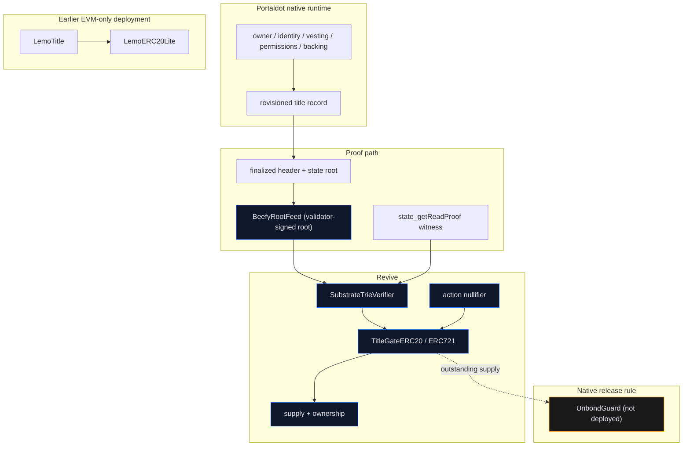
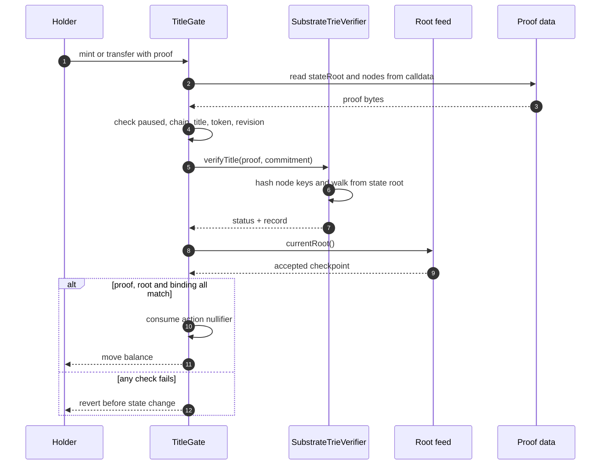

<div align="center">

# LEMO

### One asset. Two rooms. One title both rooms must obey.

[](https://lemo-ebon.vercel.app)
[-16a34a?labelColor=0f1420)](#live-status)
[](#tests)
[](#tests)
[](#tests)
[](#tests)

[](#live-status)
[](https://lemo-ebon.vercel.app/console/prove)
[](#-see-it-in-one-command)
[](#verify-every-claim-in-one-command)
[](#whats-real-vs-pending--the-honesty-table)
[](https://youtu.be/ECUvtUzc0I8)

</div>

Portaldot V3 has two ways to hold an asset. In the native room a title has an owner, backing, identity, vesting and permissions. In the Revive room an ERC-20 moves through Solidity. Both settle under the same finality, but they do not share storage.

A token can move in the Revive room while the native room has already released the backing that made it real.

LEMO is the title both rooms have to agree on. The native record is the legal room. The Revive token is the market room. The token asks for a finalized proof of the native title before it moves, and the native side refuses to release backing while a representation is still alive. The proof is not a server call and not a bridge message. It is a storage proof against a finalized state root, verified by the contract that is about to change state.

```text
native title record  ->  finalized state root  ->  storage proof  ->  EVM gate  ->  move
EVM representation   ->  outstanding supply    ->  native unbond  ->  refuse
```

What runs on public Portaldot V3 today, with no server in the trust path:

- **The root comes from the validators.** `BeefyRootFeed` stores a native state root only when both BEEFY validators signed the MMR root that commits to its block. It is checked with `ecrecover` on-chain. There is no owner, no attester and no admin key.
- **The EVM proves native state.** On [/console/prove](https://lemo-ebon.vercel.app/console/prove), the deployed `SubstrateTrieVerifier` takes that root and a native storage proof and returns `PROVEN` with the account's real balance. Flip one proof byte and it refuses.
- **You can sign it yourself.** Connect a Portaldot wallet (Talisman, SubWallet or Polkadot.js) and sign the feed update. It lands as a signed extrinsic on the [Portaldot V3 scanner](https://scanner-testnet-v3.portaldot.dev/#/extrinsics/318890-1).
- **The token obeys a native title on the public chain.** On [/console/flow](https://lemo-ebon.vercel.app/console/flow) your wallet creates an item in Portaldot's native `nfts` pallet, then `NativeTitleToken` mints 1,000 LNT only after proving, against the validator-signed root, that your account owns that item. Burn the item natively and anyone can prove its absence; the token freezes and transfers revert on-chain. Recorded run: create [319111-1](https://scanner-testnet-v3.portaldot.dev/#/extrinsics/319111-1), mint [319198-1](https://scanner-testnet-v3.portaldot.dev/#/extrinsics/319198-1), transfer [319201-1](https://scanner-testnet-v3.portaldot.dev/#/extrinsics/319201-1), native burn [319202-1](https://scanner-testnet-v3.portaldot.dev/#/extrinsics/319202-1), freeze [319217-1](https://scanner-testnet-v3.portaldot.dev/#/extrinsics/319217-1), transfer refused [319220-1](https://scanner-testnet-v3.portaldot.dev/#/extrinsics/319220-1).
- **Both rules run end to end** on a local runtime with the title pallet: native title, finalized proof, mint, transfer, unbond refused while tokens exist, burn, unbond allowed ([/console/local](https://lemo-ebon.vercel.app/console/local)).

## Live status

| Surface | Status | The evidence |
|---|---|---|
| Marketing site and console | **Live** | [lemo-ebon.vercel.app](https://lemo-ebon.vercel.app) |
| **Validator-signed root feed** | **Live, relayed hourly** | `BeefyRootFeed` `0x0ec209f0a45d65215a59e6bce135344b16316937` ([account](https://scanner-testnet-v3.portaldot.dev/#/accounts/5CQ4AmAf4KEWnSHwu72VzF8SYVBWk4t66jRsYWXwEyf3rzWv), [deploy 316946-1](https://scanner-testnet-v3.portaldot.dev/#/extrinsics/316946-1)); accepts a state root only with both BEEFY validators' signatures, the MMR root and the header; no owner, no attester. Checked live in the browser on [/console/finality](https://lemo-ebon.vercel.app/console/finality) |
| **Native title → EVM token, public chain** | **Live, wallet-signed** | `NativeTitleToken` `0xbfe32cc991738b850260c6b2cd32bb15b510c4d4` ([deploy 319127-1](https://scanner-testnet-v3.portaldot.dev/#/extrinsics/319127-1), deposit 391.18 tPOT) on [/console/flow](https://lemo-ebon.vercel.app/console/flow): `nfts` item created natively → proven under the BEEFY root → 1,000 LNT minted to the owner's mapped address → transferred → item burned natively → absence proven → frozen → transfer refused on-chain. Six extrinsics, listed above |
| **Prove native state in the EVM** | **Live, no wallet** | [/console/prove](https://lemo-ebon.vercel.app/console/prove): paste any SS58 address; the deployed `SubstrateTrieVerifier` proves its native `System.Account` record against the feed's validator-signed root by `eth_call`, and the proven balance matches the node (relayer account: `PROVEN`, 106.7645 tPOT on both sides at block #317,386) |
| **Sign the feed update with your own wallet** | **Live, on the scanner** | same page: a Talisman, SubWallet or Polkadot.js account signs `utility.batchAll` of `revive.call`s to the feed, one per validator set it missed. First one: [extrinsic 318890-1](https://scanner-testnet-v3.portaldot.dev/#/extrinsics/318890-1), three calls, feed moved from set 534 to 537, fee 0.3637 tPOT |
| **One-click relay** | **Live** | same page, **Advance the feed now**: the server relayer pays gas for validator-signed calldata; first press included in EVM block #317,395 (`0xab43e7e4…ed7052b6`) |
| Scheduled relayer | **Live** | [`.github/workflows/relay-beefy.yml`](.github/workflows/relay-beefy.yml), hourly, funded with 106.76 tPOT (about five weeks at ~0.12 tPOT a submit); anyone can run `scripts/relay-beefy.mjs`. First CI round advanced the feed from set 533 to 534 |
| Full local lifecycle | **Recorded, re-verified in the browser** | [/console/local](https://lemo-ebon.vercel.app/console/local): native title → GRANDPA-finalized proof → mint → transfer → unbond refused while live → burn → unbond allowed, 9/9 browser checks |
| Blake2b adapter | **Live on Portaldot V3** | `0x15ae34fa8fd933d6d4e1cf9a772b305f0abc7e22`; [account](https://scanner-testnet-v3.portaldot.dev/#/accounts/5CZ8cWRiFMjyLbQwhAMiJdJ9RLyTw3YJjjZy2vCXM1vdSani), [deploy 294148-1](https://scanner-testnet-v3.portaldot.dev/#/extrinsics/294148-1) |
| Trie verifier | **Live on Portaldot V3** | `0xe5ca668667d3e2c8a0272ee4e446d6aa88a86bac`; [account](https://scanner-testnet-v3.portaldot.dev/#/accounts/5HFzwxCtJFj8q7eETYTqFxdG2wnEwJCdLVBHpeYEivwitwGw), [deploy 294498-1](https://scanner-testnet-v3.portaldot.dev/#/extrinsics/294498-1) |
| Root feed | **Live, root attested** | `0xc1c95be2f38f865438f684d269f340f5c505d5c0`; [account](https://scanner-testnet-v3.portaldot.dev/#/accounts/5GSnv2LBRuf7hikmh39R8ws5qwi6moH6AGgHTSeRykGC5fdY), [deploy 294249-1](https://scanner-testnet-v3.portaldot.dev/#/extrinsics/294249-1); root `0x19ff…8b80` = state root of [#294515](https://scanner-testnet-v3.portaldot.dev/#/blocks/294515) |
| ERC-20 gate | **Live, paused after the burn fix** | `0xfbefe3cbf0785b3d08814eb02a348c9ca296741f`; [account](https://scanner-testnet-v3.portaldot.dev/#/accounts/5Hm38ynRjaM2qRdje35XJbD6CsYcAXX1TEuHcwub7ju69EJf), [deploy 294503-1](https://scanner-testnet-v3.portaldot.dev/#/extrinsics/294503-1); deployed bytecode predates the holder-only burn fix |
| `UnbondGuard` | **Not deployed** | Rule 2 logic tested; no live address |
| Earlier EVM-only deployment | **Live, settled receipts** | [`/console/legacy`](https://lemo-ebon.vercel.app/console/legacy); registry `0xc887…88bB`, token `0x61c3…8ff7` |
| Transaction receipt view | **Live** | `/tx/<hash>`; reads the receipt from the Portaldot V3 EVM RPC |
| Portaldot V3 scanner links | **Live** | every deployment, contract account and receipt block links to [scanner-testnet-v3.portaldot.dev](https://scanner-testnet-v3.portaldot.dev/#/accounts/5GEXs8zz7giva7C2FcoLmTM4TgH6HgzSPZF7Qzj8n742tiVx); EVM transactions are unsigned `revive.ethTransact` extrinsics, which the scanner does not list, so they link to their block |
| Native title registry | **In the local runtime, not in public V3** | `pallets/lemo-title`, 22 tests; built into a local solochain runtime ([docs/LOCAL_RUNTIME.md](docs/LOCAL_RUNTIME.md)) |
| Four-contract mint / transfer (pallet title) | **Wired, cannot settle on public V3** | placeholder commitment; the public runtime has no title pallet. The `nfts`-item title above is what settles publicly |
| Proof service | **1,094 tests passing** | `server/`; origin allowlist, rate limit, bounded proofs |
| Security audit | **Self-audit; findings fixed in source** | [docs/AUDIT.md](docs/AUDIT.md); every Critical/High/Medium/Low fixed in source with a regression test; the deployed gate predates the fixes and stays paused |

The honest line: roots on Portaldot V3 come from the validators' own signatures, checked on-chain; native state is proven inside the EVM on the public chain; and the full two-rule lifecycle runs end to end on a local runtime. The public V3 runtime has no LEMO title pallet, so the original gate stays paused; on public V3 the title is an item of the native `nfts` pallet instead, and Rule 1 settles against it.

## The 20-second pitch

Every wrapped asset answers "where is the backing?". LEMO asks a harder question: **does the token still have the right to exist?** The EVM gate checks a finalized native title proof before a mint, transfer or burn. The native side refuses to release backing while a representation is outstanding. The unit of authorisation is a revisioned title — backing, owner, identity, vesting and permissions in one commitment — not a balance. Every failed check reverts before a balance moves.

Most cross-runtime designs check one direction: the token side asks whether backing exists. LEMO checks both directions. The EVM side proves the native record before anything moves, and the native side refuses to release backing while the EVM representation is alive. Removing either rule opens a hole the other cannot close, and the tests for both are in this repository.

## How Portaldot is load-bearing, in plain words

Short version: **Portaldot is not a host; it is one of the two ledgers under test.**

1. **Native state.** The title record belongs in the native runtime, with backing, owner, identity, vesting, permissions and a monotonic revision.
2. **Revive state.** The ERC-20 representation lives in Revive, with balances, supply and a proof check before every movement.
3. **tPOT.** The native wallet pays the storage deposit for the contracts; an EVM address is only a mapped account.
4. **State proofs.** `state_getReadProof` at a finalized block is the input the Solidity verifier walks.
5. **Finality.** Both rooms settle under the same validator set. `BeefyRootFeed` takes a state root only when Portaldot's BEEFY validators signed the MMR root that commits to its block, checked with `ecrecover` on-chain. The one thing fixed at deploy is the starting validator set ([docs/FINALITY.md](docs/FINALITY.md)).

## Judge walkthrough (5 minutes)

Every step below runs on the public site. The read pages need no wallet and no install. Do not click Mint; it is paused on purpose.

1. **Open [lemo-ebon.vercel.app](https://lemo-ebon.vercel.app).** The security band says `VALIDATOR-SIGNED ROOTS`, `NATIVE STATE PROVEN IN THE EVM`, `GATE PAUSED`, `ETH_GETPROOF REFUSED`. That is the current boundary, not marketing.
2. **Open [/console](https://lemo-ebon.vercel.app/console).** Check the finalized native height, the Revive head, the native/Revive identity row, and the state roots. Every number is read from the node, not fixture data.
3. **Open [/console/proofs](https://lemo-ebon.vercel.app/console/proofs).** The native witness and the EVM probe run side by side. The EVM side reports `eth_getProof` refusing; the native side returns a witness. The refusal is shown verbatim.
4. **Open [/console/verify](https://lemo-ebon.vercel.app/console/verify).** Prove one storage key against the finalized state root. The page walks the returned trie nodes in the browser; a tampered node or root is rejected.
5. **Open [/console/network](https://lemo-ebon.vercel.app/console/network).** Read the endpoint, genesis, chain id and latency checks. A failed check is reported as failed, never hidden.
6. **Open [/console/legacy](https://lemo-ebon.vercel.app/console/legacy).** This is the earlier EVM-only deployment. Verify supply `1,000`, cap `1,000`, eligibility `true`, issuer balance `985`, and five settled transaction receipts. Click any hash to open `/tx/<hash>`; the receipt is read live from the Portaldot V3 EVM RPC. This is the only place a **settled** mint and transfer can be shown today.
7. **Open [/console/finality](https://lemo-ebon.vercel.app/console/finality).** The newest BEEFY block is checked in the browser: both validator signatures recovered, the MMR root rebuilt from on-chain peaks, the header hashed to the signed parent, the state root read out. The on-chain feed's `currentRoot` is compared with the same header. Flip a signature byte and the verdict turns FAIL.
8. **Open [/console/local](https://lemo-ebon.vercel.app/console/local).** The full two-rule lifecycle from a local runtime with the pallet: create title, finalized proof, mint, transfer, unbond refused while tokens exist, burn, unbond allowed and the deposit returned. Headers, GRANDPA signatures and storage proofs are re-checked in the browser.
9. **Open [/console/prove](https://lemo-ebon.vercel.app/console/prove).** Click **Prove on-chain**, or paste your own Portaldot address first. The verifier contract on Portaldot returns `PROVEN` for that account's native record under the validator-signed root, and the decoded balance equals what the node reports. Tick **flip one proof byte** and the contract returns `INCOMPLETE`. Click **Advance the feed now** to send a real transaction that moves the root forward; the hash links to its receipt and block. To sign it yourself, connect a Portaldot wallet extension holding a little tPOT under **Sign the update yourself** and click **Sign and submit**; the result links to the extrinsic on the Portaldot V3 scanner.
10. **Open [/console/flow](https://lemo-ebon.vercel.app/console/flow) (Transact)** with a Portaldot wallet extension holding about 35 tPOT. Click **Create native title**, then **Prove and mint 1,000 LNT**, then transfer some LNT, then **Burn native title** and **Prove it and freeze**. A transfer after that is refused. Every step is an extrinsic you sign, linked to the scanner. If mint says the title is not in the newest signed block yet, wait 30 seconds; BEEFY signs a few blocks behind the head.
11. **Rule 2 on public V3 is the freeze, not an unbond refusal.** The `nfts` pallet cannot be told to refuse a burn, so on the public chain the EVM side obeys the native side instead: once the item is gone, the token stops moving. The native unbond refusal needs `pallets/lemo-title`; step 8 shows it on the local runtime.

Portaldot's official explorers are Substrate scanners; they do not index EVM receipts. That is why the receipt view is part of this site and reads `eth_getTransactionReceipt` directly. It is a receipt viewer, not a replacement for a chain-wide indexer.

What a judge can verify without trusting the site: the addresses and code on Portaldot V3, the six deployment extrinsics in [docs/EVIDENCE.md](docs/EVIDENCE.md), the signed feed update [318890-1](https://scanner-testnet-v3.portaldot.dev/#/extrinsics/318890-1), `currentRoot()` on the feed by any `eth_call`, the five legacy receipts on `/console/legacy`, and the local test suites in [Tests](#tests).

## Table of contents

- [Live status](#live-status)
- [The 20-second pitch](#the-20-second-pitch)
- [How Portaldot is load-bearing, in plain words](#how-portaldot-is-load-bearing-in-plain-words)
- [Judge walkthrough (5 minutes)](#judge-walkthrough-5-minutes)
- [See it in one command](#-see-it-in-one-command)
- [Verify every claim in one command](#verify-every-claim-in-one-command)
- [What LEMO is NOT](#what-lemo-is-not)
- [The problem I set out to solve](#the-problem-i-set-out-to-solve)
- [What I built](#what-i-built)
- [Architecture](#architecture)
- [The two rules, step by step](#the-two-rules-step-by-step)
- [Where the guarantee is enforced](#where-the-guarantee-is-enforced)
- [The live run](#the-live-run)
- [Why the native mint does not work](#why-the-native-mint-does-not-work)
- [The replacement we shipped](#the-replacement-we-shipped)
- [The burn fix and the pause](#the-burn-fix-and-the-pause)
- [Engineering decisions & the traps that taught me something](#engineering-decisions--the-traps-that-taught-me-something)
- [What's real vs pending — the honesty table](#whats-real-vs-pending--the-honesty-table)
- [Attack → test](#attack--test)
- [Limitations](#limitations)
- [Security](#security)
- [Tech stack](#tech-stack)
- [Project layout](#project-layout)
- [Full command reference](#full-command-reference)
- [How I'd deploy it](#how-id-deploy-it)
- [Tests](#tests)

## ▶ See it in one command

```bash
npm install && npm run dev
```

Open `http://localhost:3000` for the landing page, `/console` for the readings and `/console/legacy` for the settled predecessor. The app reaches Portaldot through the same-origin `/api/rpc/*` proxies; no wallet is needed for the read pages.

For the production build:

```bash
npm run build && npm run start
```

## Verify every claim in one command

```bash
export PATH="$HOME/.foundry/bin:$PATH"
npx tsc --noEmit
forge test
(cd server && npm test)
(cd pallets/lemo-title && cargo test)
```

```text
forge test                        165 passed, 0 failed
local-evm forge test               10 passed, 0 failed
server npm test                 1,094 passed, 0 failed
cargo test (pallet)                22 passed, 0 failed
total                           1,291 passed
```

On macOS, if the pallet fails to link because CommandLineTools ships a newer SDK than clang accepts, point `SDKROOT` at the SDK clang accepts (here `MacOSX26.5.sdk`) for that command. The failure is a local toolchain fault, not a test failure.

The contract addresses, deposits and deploy extrinsics are in [docs/EVIDENCE.md](docs/EVIDENCE.md); the five legacy receipts are read live on `/console/legacy`. Read the feed yourself with no tooling beyond curl:

```bash
curl -s https://test-evm-rpc-v3.portaldot.dev -H 'content-type: application/json' \
  -d '{"jsonrpc":"2.0","id":1,"method":"eth_call","params":[{"to":"0x0ec209f0a45d65215a59e6bce135344b16316937","data":"0x50974e31"},"latest"]}'
```

```text
{"jsonrpc":"2.0","id":1,"result":"0x0000000000000000000000000000000000000000000000000000000000000219"}
```

`0x50974e31` is `validatorSetId()`; `0x219` is set 537, the BEEFY set the feed last accepted when this was written.

## What LEMO is NOT

- **Not a bridge.** No asset is locked on one chain and minted on another by a relayer. The verifier checks a proof against a root both sides already accept.
- **Not a wrapper.** The EVM token is not a claim on a custodian. It is a second face of the same title, gated by the native record.
- **Not a server authority.** The proof service carries bytes and verifies them; it cannot make a bad proof pass.
- **Not a live native asset system on public V3 yet.** The title pallet runs in a local runtime, not the public one, so the public gate has no real title to prove. The site says so.
- **Not a trusted relayer.** Anyone can relay, from a script, a GitHub Action, the server button or their own wallet. The feed checks the validators' signatures; whoever pays the gas chooses nothing.
- **Not audited.** [`docs/AUDIT.md`](docs/AUDIT.md) is a self-audit, not a third-party sign-off.
- **Not the earlier deployment.** `/console/legacy` is an EVM-only predecessor with real receipts. It is not the dual-runtime gate and must not be presented as one.

## The problem I set out to solve

Portaldot V3 has two ways to hold an asset and no shared contract storage between them.

- Native ownership rules do not automatically follow an ERC-20 or ERC-721 representation.
- Solidity applications see a token, not the identity, vesting or permissions behind it.
- Backing can leave while a representation still circulates.
- The usual fix is a synchronization service that becomes the authority.

Wrapping an asset moves it. It does not enforce the relationship between the original backing and its representation. LEMO makes the relationship the unit that both rooms have to accept.

## What I built

- **Solidity verifier**: walks blake2b-256 Substrate trie nodes from a state root, decodes a 320-byte title record, and returns a typed status.
- **Title gates**: ERC-20 and ERC-721 variants that bind chain, title, token, operation, revision, root and commitment before any balance moves.
- **Public native title token**: `contracts/NativeTitleToken.sol`, an ERC-20 that mints once per `nfts` item to the owner's mapped address after a trie proof under the validator-signed root, and freezes on a proof that the item was burned or sold natively; 12 tests on a captured item.
- **Root feeds**: `BeefyRootFeed` (validator-signed, no attester, live), a single-attester `RootFeed` and an M-of-N `ThresholdRootFeed`.
- **Relayers**: `scripts/relay-beefy.mjs` plans one submission per missed validator set and is run hourly by CI; `/api/relay` pays gas for validator-signed calldata from the console; `lib/wallet/sign.ts` lets a visitor's own wallet sign the same calls as one batched extrinsic.
- **Live native-state proof**: `lib/live-proof.ts` fetches `state_getReadProof` at the feed's block and asks the deployed verifier for the verdict by `eth_call`.
- **Unbond guard**: Rule 2 in Solidity, with a release recheck and one open request per title.
- **Native pallet**: `pallets/lemo-title`, with create, edit, representation, fail-closed liveness and three-phase unbond (request, cancel, finalize), a creation deposit and caller-derived title ids; 22 tests.
- **Proof service**: a Fastify service with typed RPC clients, trie verification, fixtures and 1,094 tests.
- **Console**: landing, overview, proof walk, key verifier, network checks, validator-signed roots, the live native-state proof, a transaction surface, a read-only page for the earlier deployment, and a local lifecycle page (a recorded native + anvil run, re-verified in the browser).
- **Local lifecycle**: a solochain runtime with `pallets/lemo-title`, a 320-byte canonical record, `scripts/local-e2e.mjs` driving the full native + anvil lifecycle, and Foundry tests that replay it (10 tests).
- **Deployment tooling**: `revive.instantiateWithCode` from the native SS58 wallet, plus the Foundry path and cost measurement.

## Architecture



The arrows carry bytes, not calls. Each environment verifies a proof against a state it already trusts. A relayer can carry a proof; it cannot make a bad proof verify. The earlier EVM-only path is separate; it does not connect to the native proof path.



| Component | File | Role |
|---|---|---|
| Trie verifier | `contracts/SubstrateTrieVerifier.sol` | walk a Substrate proof from a state root |
| Gate base | `contracts/TitleGateBase.sol` | bind chain, title, token, operation, root, revision |
| ERC-20 gate | `contracts/TitleGateERC20.sol` | cap, owner-bound mint, holder-only burn |
| ERC-721 gate | `contracts/TitleGateERC721.sol` | owner-bound mint and ERC-165 |
| Public title token | `contracts/NativeTitleToken.sol` | mint against an `nfts` item proof, freeze on its absence |
| Validator-signed feed | `contracts/BeefyRootFeed.sol` | BEEFY signatures, MMR root and header checked on-chain |
| Root feed | `contracts/RootFeed.sol` | one attested checkpoint |
| Threshold feed | `contracts/ThresholdRootFeed.sol` | M-of-N attestation |
| Unbond guard | `contracts/UnbondGuard.sol` | Rule 2, release recheck, one open request |
| Native pallet | `pallets/lemo-title/src/lib.rs` | title storage and native calls |
| Proof service | `server/` | RPC clients, verifier, fixtures |
| Relayer | `scripts/relay-beefy.mjs`, `app/api/relay/route.ts`, `app/api/relay/next/route.ts` | plan and pay for feed updates |
| Wallet signing | `lib/wallet/sign.ts` | the visitor's wallet signs the feed update |
| Live proof | `lib/live-proof.ts`, `app/console/prove/page.tsx` | native proof, verified by the deployed contract |
| Earlier deployment | `contracts/src/LemoTitle.sol`, `contracts/src/LemoERC20Lite.sol` | EVM-only predecessor with receipts |

## The two rules, step by step

### Rule 1: the EVM gate checks the native title

1. Read `chain_getFinalizedHead` and the header at that hash.
2. Ask `state_getReadProof` for the title's storage key at that block.
3. Index every returned node by `blake2b_256(node)`.
4. Walk from the state root, consuming partial keys and branch nibbles.
5. Decode the 320-byte title record.
6. Recompute the commitment and compare it with the gate's title commitment.
7. Check the chain, title id, token address, operation, revision and current feed root.
8. Consume the action nullifier and only then move the balance.

### Rule 2: the native side checks the representation

`UnbondGuard.requestUnbond` refuses while `representationOutstanding()` is true, spends the proof's nullifier and records one open request per title. `completeUnbond` re-checks `representationOutstanding()` at release time, so a burn → request → re-mint sequence cannot release backing twice.

The native pallet implements the same rule as `request_unbond` with a `RepresentationLive` check that must be an explicit `Some(false)`; an unset flag is fail-closed. The pallet is source and tests, not a runtime deployment.

## Where the guarantee is enforced

| Guarantee | Enforced by |
|---|---|
| No EVM state change without a current native proof | `TitleGateBase._gate`, `SubstrateTrieVerifier.verifyTitle` |
| A proof cannot be replayed for the same action | action-scoped nullifier in `TitleGateBase` |
| A mint cannot exceed the supply cap | `TitleGateERC20.maxSupply` |
| A mint cannot be front-run to another recipient | `mint` binding to `record.owner` |
| A burn cannot destroy another holder's balance | `burn` holder check |
| Native release is blocked while a representation exists | `UnbondGuard.requestUnbond` and `completeUnbond` |
| Unknown liveness cannot authorise an unbond | `RepresentationLive` `OptionQuery` + `Some(false)` |
| The node cannot invent the value | verifier returns `ABSENT`, `INCOMPLETE`, `INVALID`, `ROOT_MISMATCH` or `VALUE_MISMATCH` |

## The live run

### Why the native mint does not work

A settled four-contract mint needs four things at once, and only two exist on the public chain:

1. **A native title record** at a real storage key in the Portaldot runtime. `pallets/lemo-title` is not in the runtime, so the key does not exist.
2. **A finalized state root that contains that key.** `RootFeed` holds a real root, but it contains no LEMO title.
3. **A valid Substrate storage proof from that root.** The verifier can check one; there is nothing to prove.
4. **A gate commitment and revision matching that record.** The deployed gate has a placeholder commitment and `acceptedRevision = 0`.

The gate is also paused after the burn fix, but unpausing would not help: the proof check would still reject. There is no owner bypass in `mint`; that is deliberate. The same gap blocks native create, identity, unbond and the Rule 2 refusal.

### The replacement we shipped

The repository contains an **earlier EVM-only deployment**, and it has settled transactions on Portaldot V3:

| Contract | Address | Live reading |
|---|---|---|
| `LemoTitle` | `0xc88763FA361669fC5d95c2BDD924b0E2872488bB` | title `0xeeee…eeee`; backing `1,000`; revision `292498`; eligible `true` |
| `LemoERC20Lite` | `0x61c35d5e811b99f2641b43e9ef97e50d52de8ff7` | supply `1,000`; cap `1,000`; issuer holds `985` |

It has five settled receipts, read live on [`/console/legacy`](https://lemo-ebon.vercel.app/console/legacy):

| Action | Transaction | Block |
|---|---|---|
| Mint 1,000 | `0xe7391b28393c1273b0d9e5316725408c57e189b2ee34447fe77c8cb1ace8b525` | 292633 |
| Transfer 10 | `0x82cf8b4ea676eb30b29e31ab9019c571fd650c2d27e2c10e88cba7bf9478c11f` | 292634 |
| Freeze title | `0xc038a6d31cd1076a0dfe60b0267b28b4bc85458af15ee8582a3cf2bb4a599a2f` | 292639 |
| Unfreeze title | `0xd8958bbf3de0dfc42cab20b8d1a013da4cd1a44c550b107e58f7e791c9e4f068` | 292640 |
| Transfer 5 | `0xfab5374ab496e3211379d0cce42475b681748f105652c03fe7d8268aad7f95b8` | 292641 |

This replacement proves that an ERC-20 can be minted to a cap and moved while a registry says the title is eligible. It also proves a transfer refusal while frozen and a working transfer after unfreeze.

It does **not** prove a native record, a Substrate storage proof, Rule 2, an unbond, or the four-contract gate. The registry is EVM storage. The issuer key is not held by the console, so the page is read-only. Present it as "the earlier on-chain deployment", never as the dual-runtime gate.

### The burn fix and the pause

The independent review found a real defect in `TitleGateERC20.burn`: the gate owner could burn **any holder's** balance, and burning the supply would make `representationOutstanding()` false and release native backing. The fix in source:

- `burn` now allows only the holder (`msg.sender == from`).
- `transfer` now binds `msg.sender` in the action hash, matching `transferFrom`.
- `test_GateOwnerCannotBurnAHolder` asserts the owner path reverts.
- Foundry grew from 89 to 90 tests at the time; the later audit pass brought it to 153, and the public title token to 165.

The deployed gate cannot be patched. It was **paused** at `0xfc7fb72e7c56c9e723dbc03032a06e82ad018174f22f12559a364502245a05bf`; `paused()` reads `true`. A clean live fix needs a new gate and a new verifier: the deployed verifier exposes the old `verifyTitle` signature, and the fixed gate is 8,232 bytes of initcode. Together that is about 1,360 tPOT at the measured rate. The tPOT went to the validator-signed feed and its relayer first, because they change what every future gate can trust, and because a redeployed public gate still could not mint without the title pallet in the public runtime. Until then the live gate stays paused and the README says so.

## Engineering decisions & the traps that taught me something

1. **Measure the deposit, don't estimate it.** `scripts/dry-run-deposit.mjs` runs `ReviveApi_instantiate` read-only and returns the exact storage deposit. The first BEEFY feed design needed 352.88 tPOT against a 274.63 wallet; dropping the storage-proof rotation brought it to 254.52, and it deployed.
2. **Storage is the cost.** Portaldot charges `0.06 tPOT` per code byte plus a 30% code-hash lockup. A 779-byte hasher costs 71.78 tPOT; the four-contract suite cost about 1,378 tPOT. Measure before broadcasting.
3. **tPOT is native.** An EVM address holds its tPOT through the `H160 ++ 0xEE*12` mapping. Funding the `0x` address directly does nothing.
4. **EVM constructor arguments belong in the code blob.** `revive.instantiateWithCode` rejects separate `data` with `EvmConstructorNonEmptyData`.
5. **The weight limit must fit the block.** Passing `maxEthExtrinsicWeight` returns "Transaction would exhaust the block limits"; `1.5e12` refTime works for one call. Three feed calls at `1.5e12` each fail the same way, so the wallet path dry-runs the first call with `ReviveApi_call` and sizes every call at 1.6× its measured weight.
6. **The public RPC drops bursts.** Browser calls were blocked by CORS on 503. The app uses same-origin `/api/rpc/*` proxies with a retry and a short cache.
7. **The Vercel build typechecks the repo.** The merged `backend/` package uses `.ts` imports; the root `tsconfig` excludes it so `next build` stays green.
8. **The chart needs a height before it can measure.** `ResponsiveContainer` now has `minHeight={240}`.
9. **BEEFY, not GRANDPA, for on-chain finality.** GRANDPA signs with ed25519 and Revive has no ed25519 precompile. BEEFY signs keccak256 of the commitment with secp256k1, which `ecrecover` checks for a few thousand gas.
10. **The public node cannot serve MMR proofs.** `mmr_generateProof` returns `LeafNotFound` because offchain indexing is off. The on-chain peaks at N-1 plus the newest leaf rebuild the signed root at N, which is all a feed needs.
11. **The scanner lists signed extrinsics only.** An EVM transaction is an unsigned `revive.ethTransact`, so receipts link to their block; native deployments link to the extrinsic. That is why the visitor's update is a native `revive.call`, not an EVM transaction: it shows up on the scanner as an extrinsic with the signer's address.
12. **A feed that rotates implicitly must be walked one set at a time.** The feed accepts a commitment for its stored set id or the next one. When the hourly job slipped, BEEFY moved from set 534 to 537 and the newest justification reverted with `WrongSetId(537, 534)`. The planner now finds one justified block per missed set and the wallet signs all of them in one `utility.batchAll`.

## What's real vs pending — the honesty table

| Claim | Status | Evidence |
|---|---|---|
| Contracts deployed on Portaldot V3 | **Yes, six** | addresses above, `docs/EVIDENCE.md` |
| Root feed has an attested finalized root | **Yes** | `currentRoot` at block 294515 |
| Roots proven by validator signatures on-chain | **Yes** | `BeefyRootFeed` `0x0ec2…6937`, live and relayed; `/console/finality` |
| Native state proven by a contract on public V3 | **Yes** | `/console/prove`: the deployed verifier returns `PROVEN` for a native `System.Account` record under the feed's root |
| A visitor can sign a real transaction | **Yes** | wallet path on `/console/prove`; [318890-1](https://scanner-testnet-v3.portaldot.dev/#/extrinsics/318890-1) |
| Solidity verifier passes a real Substrate proof | **Yes** | `test/SubstrateTrieVerifier.t.sol` |
| Browser verifier passes a real Substrate proof | **Yes** | `server/test/fixtures/portaldot-v3.json` |
| Earlier deployment minted and transferred | **Yes** | five settled receipts on `/console/legacy` |
| A token settles against a real native title on public V3 | **Yes** | `nfts` item 12/0 → mint 319198-1 → freeze 319217-1 → refused 319220-1 |
| The original gate binds a pallet title on public V3 | **No** | placeholder commitment; the public runtime has no title pallet; the local run binds a real one |
| Original four-contract mint and transfer settle | **Local only** | public gate paused; the public settlement path is `NativeTitleToken` |
| Native registry is live | **Local runtime only** | public V3 runtime does not include the pallet |
| Rule 2 is enforced on native | **Local runtime: yes** | `request_unbond` refused with `RepresentationLive`, then allowed after burn, on `/console/local`; not on public V3; `UnbondGuard` not deployed publicly |
| Independent root source | **Yes, for the new feed** | `BeefyRootFeed` has no attester; the paused public gate still points at the older single-attester `RootFeed` |
| External audit | **No** | self-audit only |

## Attack → test

| Attack | Test that refuses it |
|---|---|
| Mint without backing | `test_01_MintWithoutBacking` |
| Mint with no proof | `test_02_MintWithNoProof` |
| Burn another holder's balance | `test_BurnByAnOutsiderIsRefusedBeforeTheProof` |
| Gate owner burns a holder | `test_GateOwnerCannotBurnAHolder` |
| Replay the same action | `test_06_ProofDoubleSpend` |
| Replay after a new root | action-scoped nullifier + `test_RevertOnReplayedProof` |
| Use a mint proof to burn | `test_05_BurnWithAMintProof` |
| Burn proof to mint | `test_08_BurnProofCannotMint` |
| Stale root | `test_15_StaleRoot` |
| Wrong token contract | `test_16_WrongTokenBinding` |
| Wrong revision | `test_18_RevisionClaimDoesNotMatchTheRecord` |
| Cleared identity | `test_19_ClearedIdentity` |
| Unbond while supply is outstanding | `test_12_UnbondWhileRepresentationOutstanding` |
| Complete an unbond after a re-mint | `test_21_CompletedUnbondRechecksRepresentation` |
| Two open unbonds for one title | `test_22_OnlyOneOpenUnbondPerTitle` |
| Zero-recipient mint | `test_MintCannotExceedTheCommittedSupplyCap` + ERC-721 zero check |
| Unknown native liveness | `unbond_is_refused_while_representation_state_is_unknown` |
| Mint a title you do not own natively | `test_RevertClaimBySomeoneElse` |
| Mint twice from one native title | `test_NativeOwnerClaimsOnce` |
| Mint from a tampered native proof | `test_RevertClaimWithTamperedProof` |
| Mint under a root the validators did not sign | `test_RevertClaimUnderAnotherRoot` |
| Mint for an item that does not exist | `test_RevertClaimForMissingItem` |
| Pass a key from another pallet | `test_RevertKeyFromAnotherPallet` |
| Freeze a title its owner still holds | `test_RevertFreezeWhileOwnerStillHolds` |
| Keep trading after the native burn or sale | `test_NativeBurnFreezesTheRepresentation`, `test_NativeSaleFreezesTheRepresentation` |
| Root signed by only one validator | `test_RevertOneSignatureMissing` |
| One validator signs twice | `test_RevertDuplicateSignature` |
| Signature from a key outside the set | `test_RevertSignerNotInSet` |
| Tampered MMR root in the commitment | `test_RevertTamperedCommitmentMmrRoot` |
| Tampered state root in the header | `test_RevertTamperedHeaderStateRoot` |
| Dropped or forged MMR peak | `test_RevertDroppedPeak`, `test_RevertTamperedMmrPeak` |
| Roll the feed back to an older block | `test_RevertOlderOrSameBlock` |
| Skip a validator set | `test_RevertSetIdJumpOfTwo` |
| Next set signed by an unknown key | `test_RevertNextSetSignedByUnstoredKey` |

## Limitations

- The native registry is a pallet, not a runtime. The public V3 node does not expose the contracts API, so the native half cannot run here.
- On public V3 the title is an `nfts` item, which carries an owner but not backing, identity or vesting. Rule 2 there is the EVM freeze; the native refusal to release backing needs the title pallet (local runtime).
- `UnbondGuard` is not deployed. Rule 2 is tested but has no live address.
- The live gate is **paused** and its bytecode predates the holder-only burn fix. The source is fixed and tested; the deployed gate must be redeployed before any live use.
- The live gate's commitment is a placeholder. It is a real contract with a real verifier, but there is no real title to prove.
- The paused public gate reads the older single-attester `RootFeed`; a gate's feed is immutable. The validator-signed `BeefyRootFeed` is live beside it, and a gate redeploy pointed at it is the next deployment (new verifier plus gate, about 1,360 tPOT). `BeefyRootFeed` follows set-id changes but stalls if BEEFY membership changes; it can stall, but it cannot accept a root the validators did not sign.
- The pallet now stores a 320-byte `CanonicalTitles` blob and the EVM proof carries the full 80-byte storage key. H-06 is closed in source: the record carries an explicit `evm_beneficiary` address instead of truncating `AccountId32`. The public runtime still does not include this pallet.
- A distinct action at the same revision gets a distinct nullifier; the audit's H-01 notes that a true per-revision spend counter is still the stronger design.
- No external audit. The self-audit is in [`docs/AUDIT.md`](docs/AUDIT.md).

## Security

- [`docs/AUDIT.md`](docs/AUDIT.md): 28 findings, all fixed in source with regression tests. C-01: one mint per native revision, exactly the cap, to the proven owner (the frozen 320-byte record has no amount field). H-01: mint and burn are revision-scoped; transfers stay action-scoped by design.
- Mitigations: supply cap, recipient binding, holder-only burn, action-scoped nullifier, unbond release recheck, one open request per title, zero-recipient refusal, ERC-165.
- The proof service never accepts a caller-supplied state root.
- The public RPC proxy uses a method allowlist and does not expose wallet-signing methods.
- The earlier deployment's issuer key is not held by this console; `/console/legacy` is read-only.

## Tech stack

- Next.js 16 App Router, React 19, Tailwind v4, TypeScript
- Foundry, Solidity 0.8.26
- Substrate FRAME pallet, Rust
- Fastify proof service, TypeScript
- Portaldot V3 Revive EVM, chain id 420420777
- Vercel production deployment

## Project layout

```text
app/                 landing, console routes, /api/rpc proxy, /api/relay, /console/prove, /tx/<hash>
components/          marketing, console, wallet, flow panels
lib/                 chain reads, proofs, wallet, flow codecs, legacy reads
contracts/           gate, verifier, root feeds (BeefyRootFeed) and adapters
contracts/src/       earlier EVM-only registry and token
pallets/lemo-title/  native title registry pallet
server/              Fastify proof service
backend/             parallel proof service for the two-contract deployment
docs/                evidence, audit, finality, local runtime
test/                Foundry tests and harnesses
script/              Foundry deployment script
scripts/             native deploy, BEEFY capture and relay, local lifecycle, deposit dry run
local-evm/           Foundry replay of the local lifecycle
fixtures/            recorded local lifecycle run
```

## Full command reference

```bash
# site
npm install
npm run dev
npm run build
npm run start

# contracts
forge build
forge test

# native pallet
cd pallets/lemo-title && cargo test

# proof service
cd server && npm install && npm test

# native deployment (native tPOT wallet)
PORTALDOT_MNEMONIC=... STORAGE_LIMIT_TPOT=650 \
  node scripts/native-deploy.mjs TitleGateERC20 <constructorArgsHex>

# relay the validator-signed feed (dry run without the key)
FEED_ADDRESS=0x0ec209f0a45d65215a59e6bce135344b16316937 node scripts/relay-beefy.mjs --once

# measure a storage deposit before deploying
node scripts/dry-run-deposit.mjs <Contract>

# root attestation (older single-attester feed)
ATTESTER_PRIVATE_KEY=... FEED_ADDRESS=0xc1c9…d5c0 \
  EVM_RPC=https://test-evm-rpc-v3.portaldot.dev ./scripts/attest-root.sh
```

## How I'd deploy it

1. Include `pallets/lemo-title` in a Portaldot runtime upgrade and expose a runtime API for the fixed-width title record.
2. Create a title with real backing and identity; publish its revision.
3. Deploy a new verifier and a new gate with the holder-only burn fix, pointed at the live `BeefyRootFeed`, with the gate's title commitment set to that record.
4. Keep the feed current with the scheduled relayer; any visitor can also relay.
5. Get an external audit before calling the asset system production-ready.

## Tests

```text
forge test                        165 passed, 0 failed   (26 BeefyRootFeed on captured BEEFY data, 12 NativeTitleToken on a captured nfts item)
local-evm forge test               10 passed, 0 failed
cargo test (pallet)                22 passed, 0 failed
server npm test                 1,094 passed, 0 failed
total                           1,291 passed
```

The proof tests include a live-captured Portaldot fixture, tampered root, tampered child, wrong key, truncation, false absence and a 1,019-case stress suite. The gate tests cover stale root, old revision, unbound backing, cleared identity, wrong contract, wrong chain, wrong operation, replay, pause, supply cap, recipient binding, holder-only burn and an interrupted unbond.

---

On Portaldot V3, roots come from the validators' own signatures, checked on-chain by a contract nobody owns, and native state is proven against them inside the EVM. The full two-rule lifecycle runs end to end on a local runtime with the title pallet and is re-verified in the browser. What public V3 still lacks is the pallet itself, and the external audit.
