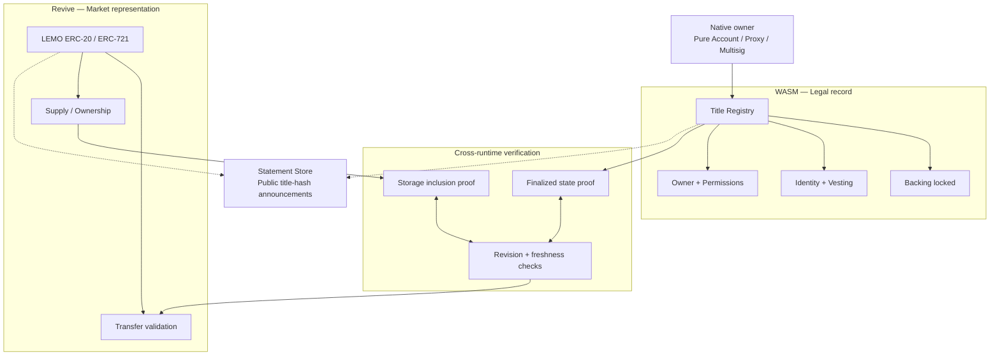

<div align="center">

# LEMO

### One asset. Two runtimes. One enforceable title.


</div>

Portaldot V3 has two contract environments. One runs native WASM contracts. The other runs EVM contracts through Revive. They share the network's validator set, but their contract storage is not automatically shared.

That creates a problem: an asset can have native backing, ownership and identity on one side, but Solidity applications on the other side have no reason to recognize that native asset.

**LEMO gives an asset one title across both runtimes.**

The WASM face is its legal record: backing, native ownership, identity, vesting and account permissions. The EVM face is its market representation: an ERC-20 or ERC-721 that existing Solidity applications can understand.

Neither face is allowed to act without cryptographically verifying the other's state.

```text
WASM TITLE                         EVM REPRESENTATION

Native backing                     ERC-20 / ERC-721
Identity                           Transfers
Vesting                            Liquidity
Proxy / Multisig ownership         Solidity applications
        │                                  │
        └──── Verified state proofs ──────┘
```

The result is one asset that can use native Portaldot ownership rules while remaining compatible with the EVM ecosystem.

## The 20-second pitch

Imagine an asset backed by 100 native units on Portaldot.

Its WASM face records the 100 units, the owner, identity requirements and vesting conditions. Its EVM face issues the corresponding ERC-20 representation.

The owner can trade that representation through Solidity applications without abandoning the native ownership rules.

But the EVM token cannot move if the native title is invalid, and the native backing cannot be unlocked while the EVM representation is still circulating.

**Two execution environments. One ownership agreement. No trusted marketplace server or privileged relayer.**

## The problem

Portaldot V3 introduces two execution environments, but having both environments does not automatically make their contract states interchangeable.

A native asset and an EVM token are separate records.

This creates several problems:

- Native ownership rules do not automatically follow an ERC-20 or ERC-721 representation.
- EVM applications cannot automatically understand native identity and vesting conditions.
- Unlocking native backing without checking the EVM representation creates a risk of unbacked circulating tokens.
- A centralized service that synchronizes the two sides introduces another party that users must trust.

Wrapping an asset is not enough. The relationship between the original backing and its representation needs to be enforced.

## What LEMO does

LEMO creates a shared title identifier with two independently maintained representations.

### 1. The WASM face — the legal record

The native side maintains:

| Record | Purpose |
|---|---|
| Backing | Locked POT or supported native assets |
| Owner | Native account controlling the title |
| Identity | Native identity requirements and status |
| Vesting | Release schedules and restrictions |
| Permissions | Pure Account, proxy or multisig ownership |
| Revision | Version of the native title state |

This is the authoritative record for native ownership and backing conditions.

### 2. The EVM face — the market representation

The EVM side exposes a familiar token interface.

| Record | Purpose |
|---|---|
| ERC-20 | Fungible representation |
| ERC-721 | Unique asset representation |
| Title ID | Reference to the native title |
| Supply / ownership | Current circulating representation |
| Revision | Last accepted native title revision |

Existing Solidity applications can interact with the token through familiar interfaces.

The EVM token does not replace the native title. It represents an asset governed by that title.

## Architecture



The proof exchange is not a contract-to-contract function call. Each environment receives proof data and must independently verify it against an authenticated finalized state.

## The core guarantee

LEMO enforces two essential rules.

### Rule 1 — EVM cannot move an invalid title

Before an ERC-20 or ERC-721 transfer, the EVM face must verify the relevant native title state.

The proof must establish that:

- The title exists.
- Its backing is still bound.
- Its native identity conditions remain satisfied.
- The title revision is current.
- The proof is finalized and sufficiently fresh.

If identity is cleared, backing is unbound or the proof is stale, the transfer reverts.

### Rule 2 — Native backing cannot be unlocked while tokens circulate

Before native unbonding, the WASM face must verify the EVM state.

The proof must establish that:

- The corresponding ERC-20 supply is zero, or all relevant ERC-721 representations have been retired.
- The proof belongs to the correct title and contract.
- The EVM state is finalized.
- The proof is current and cannot be replayed.

If any representation remains outstanding, native unbonding reverts.

```text
ERC TRANSFER

Valid native title proof?
        │
   YES ─┴─ NO
    │       │
 ALLOW    REVERT


NATIVE UNBOND

EVM representation fully retired?
        │
   YES ─┴─ NO
    │       │
 UNLOCK   REVERT
```

## The title

Every LEMO asset has one unique title identifier.

The title commits to the relationship between its two faces.

Conceptually:

```text
LEMO_TITLE = {
    title_id,
    native_asset,
    backing_amount,
    native_owner,
    identity_status,
    vesting_rules,
    evm_representation,
    evm_contract,
    revision
}
```

A versioned title hash identifies the committed state.

Changing an important title property increments its revision. Proofs from previous revisions cannot be accepted as current.

The title hash is a commitment, not proof of validity by itself. Each runtime must independently verify the underlying state.

## The lifecycle

### 1. Create

The owner creates a native title and locks the required backing.

The WASM registry records the asset, ownership, identity conditions and vesting rules.

### 2. Represent

The EVM face is created using the same title identifier.

The initial ERC-20 supply or ERC-721 ownership is established only after verifying the native backing.

### 3. Transfer

An owner transfers the EVM representation.

The EVM contract checks an authenticated, finalized proof of the native title's current eligibility before allowing the transfer.

### 4. Update

If native identity, backing or ownership conditions change, the title revision changes.

Old proofs become invalid. The EVM face must obtain an accepted proof of the new state before allowing another transfer.

### 5. Redeem

The EVM representation is returned and burned.

After the burn is finalized, a valid EVM state proof can be submitted to the native side.

Only then can the original backing be unlocked.

## Statement Store — the public noticeboard

LEMO uses Statement Store as an announcement mechanism, not as its source of truth.

A title announcement can be published to a topic such as:

```text
lemo/<title_id>
```

It contains a signed title-state announcement and the latest known title hash.

Other subscribers can discover the title and observe updates without querying a central marketplace API.

The important distinction:

**Gossip distributes information. Cryptographic proofs enforce ownership.**

Statement Store delivery is best-effort and announcements may expire. LEMO must never treat a gossip message as proof that an asset is backed or valid.

Portaldot-compatible Statement Store availability is an implementation dependency that must be verified against the target node.

## Where the guarantee is enforced

| Guarantee | Enforcement |
|---|---|
| Native backing exists | WASM title registry |
| Owner and permissions remain valid | Native title rules |
| Identity requirements remain satisfied | Native identity state and proof |
| Vesting restrictions remain satisfied | Native vesting rules and proof |
| EVM transfer has valid backing | EVM proof verifier |
| Old title revisions cannot authorize transfers | Revision and freshness checks |
| EVM supply cannot exceed its backing | Mint and burn accounting |
| Backing cannot unlock while tokens circulate | Native verification of EVM state |
| Gossip cannot authorize a transfer | On-chain verification |

## What LEMO is NOT

LEMO is not:

- A traditional cross-chain bridge moving assets between unrelated blockchains.
- A centralized wrapping service.
- A marketplace that holds custody of assets.
- A relayer that decides whether a transfer is legitimate.
- A token whose backing is verified only through a public dashboard.
- A replacement for native identity, ownership or vesting rules.

It is an ownership coordination protocol between Portaldot's native WASM and EVM environments.

## The hard engineering problems

LEMO's central challenge is cross-runtime state verification.

Sharing a validator set does not automatically give one contract environment access to the storage of the other.

The implementation must solve:

**1. State proof verification**

The WASM face and EVM face need a way to verify each other's storage proofs against authenticated finalized state roots.

**2. Finality**

A proof must be tied to a finalized block, not merely a block reported by an RPC provider.

**3. Freshness**

A previously valid proof must not authorize an operation after the underlying title has changed.

**4. Replay protection**

Proofs must be bound to the chain, title ID, runtime, contract, operation and revision.

**5. Interrupted transitions**

Issuing, burning and unlocking must be sequenced so that a failed operation cannot create an unbacked representation or release backing prematurely.

These are core protocol requirements, not optional optimizations.

## What's real vs pending — the honesty table

This repository describes the LEMO protocol design. It does not claim that the following mechanisms have already been implemented or deployed.

| Component | Status |
|---|---|
| Dual-face title model | Design |
| Proof servicing service (finalized proof packages, canonical digests, single-use replay record) | Implemented — `backend/` |
| Native backing and ownership registry | Implementation required |
| ERC-20 / ERC-721 representation | Implementation required |
| WASM-to-EVM state proof verification | Implementation required |
| EVM-to-WASM state proof verification | Implementation required |
| Finality and freshness verification | Implementation required |
| Revision and replay protection | Implementation required |
| Statement Store integration | Portaldot support and integration to verify |
| End-to-end deployment | Not yet demonstrated |
| Security audit | Not performed |

## Acceptance criteria

LEMO should not be considered complete until these checks pass.

- [ ] Create a title with real native backing on Portaldot V3.
- [ ] Establish its corresponding ERC-20 or ERC-721 representation.
- [ ] Verify native state from the EVM environment using a real finalized state proof.
- [ ] Verify EVM state from the native environment using a real finalized state proof.
- [ ] Reject transfers after native identity is cleared.
- [ ] Reject transfers after native backing is unbound.
- [ ] Reject stale or replayed proofs.
- [ ] Reject native unbonding while ERC-20 supply remains outstanding.
- [ ] Reject native unbonding while an ERC-721 representation remains outstanding.
- [ ] Demonstrate successful redemption and native unlock.
- [ ] Verify that interrupted transitions cannot create unbacked tokens.
- [ ] Demonstrate discovery through the supported gossip transport without treating gossip as authoritative state.
- [ ] Verify the complete lifecycle on the actual Portaldot V3 testnet.

## Tech stack

| Layer | Technology |
|---|---|
| Native execution | Portaldot WASM contracts |
| Native language | Rust / ink! |
| EVM execution | Portaldot Revive |
| EVM language | Solidity |
| Token interfaces | ERC-20 / ERC-721 |
| Ownership | Identity, vesting, proxy and multisig |
| State verification | Finalized headers and authenticated storage proofs |
| Discovery | Statement Store, subject to Portaldot support |
| Network | Portaldot V3 |

The EVM face is live on Portaldot V3 Test: `LemoTitle` at
`0xc88763FA361669fC5d95c2BDD924b0E2872488bB` (transactions and costs in
[`contracts/DEPLOYMENTS.md`](contracts/DEPLOYMENTS.md)).

The proof-servicing half of this design is implemented in `backend/`: it reads a title's declared
storage records at the finalized head, verifies the returned read proof against the block's own
`stateRoot`, and only then hands out a package. See `backend/README.md` for the routes, the layout
declaration format, and the limits of what the service can claim.

## Why Portaldot?

LEMO depends on the existence of both execution environments.

On a chain with only WASM, its EVM representation has nowhere to execute. On a chain with only EVM, its native ownership record has nowhere to live.

Portaldot brings both environments into the same network.

That makes it possible to explore a different asset model: native ownership rules with EVM compatibility, without making a centralized service the authority between them.

**The asset does not choose between WASM and EVM. It belongs to both, and neither can act without proving that the other agrees.**

## References

- [Portaldot Developer Documentation](https://portaldot-dev.readthedocs.io/en/latest/)
- [Portaldot Native Identity](https://portaldot-dev.readthedocs.io/en/latest/module-interface/extrinsics/identity.html)
- [Portaldot Contracts Interface](https://portaldot-dev.readthedocs.io/en/latest/module-interface/extrinsics/contracts.html)
- [Statement Store — Polkadot reference](https://docs.polkadot.com/reference/apps/infrastructure/statement-store/)
