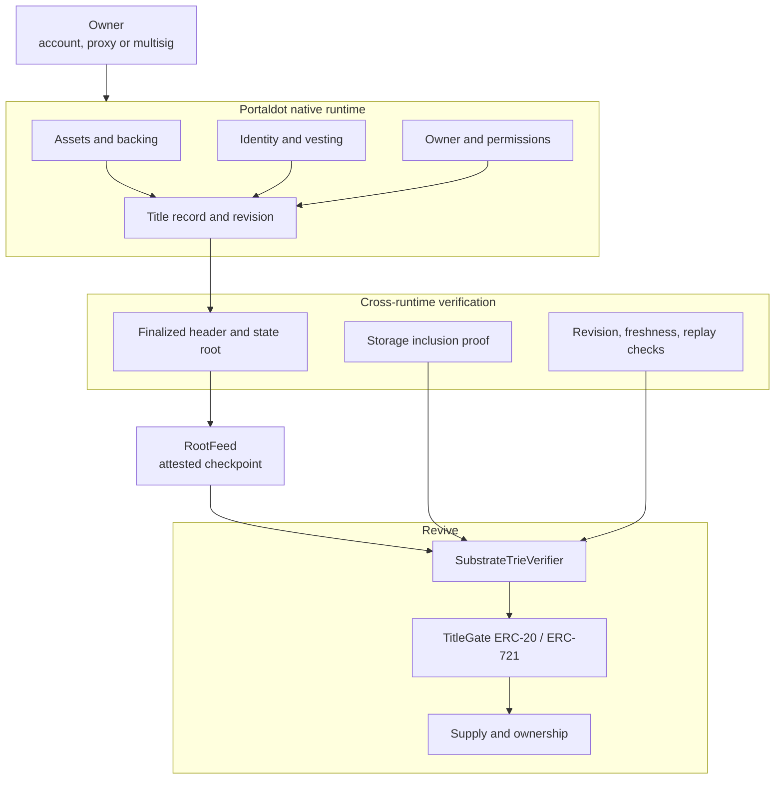

<div align="center">

# LEMO

### One asset. Two rooms. One title both rooms must obey.

[](https://lemo-ebon.vercel.app)
[](#live-status)
[](#contracts-and-tests)
[](#the-proof-service)
[](#live-status)

[Live](https://lemo-ebon.vercel.app) · [Console](https://lemo-ebon.vercel.app/console) · [Flow](https://lemo-ebon.vercel.app/console/flow) · [Protocol](#the-story) · [Evidence](docs/EVIDENCE.md) · [Audit](docs/AUDIT.md) · [Deck](deck/lemo-deck.pdf)

</div>

There are two rooms on Portaldot. In one room, an asset has a native owner, a backing balance, an identity, vesting and permissions. In the other room, a token moves through Solidity. The rooms settle under the same finality, but they do not share storage.

A token can move in the second room while the first room has already forgotten why it was allowed to exist.

LEMO is the title both rooms have to agree on. The native record is the legal room. The Revive token is the market room. Neither room gets to act alone: the token asks for a finalized proof of the native title before it moves, and the native side refuses to release backing while a representation is still alive.

The proof is not a server call and not a bridge message. It is a storage proof against a finalized state root, verified by the contract that is about to change state.

## Live status

| Surface | State | Evidence |
|---|---|---|
| Marketing site and console | **Live** | [lemo-ebon.vercel.app](https://lemo-ebon.vercel.app) |
| Transaction console | **Live, gate wired** | [/console/flow](https://lemo-ebon.vercel.app/console/flow); reads the three deployed addresses |
| Blake2b adapter | **Live on Portaldot V3** | `0x15ae34fa8fd933d6d4e1cf9a772b305f0abc7e22` |
| Trie verifier | **Live on Portaldot V3** | `0xe5ca668667d3e2c8a0272ee4e446d6aa88a86bac` |
| Root feed | **Live, root attested** | `0xc1c95be2f38f865438f684d269f340f5c505d5c0`; root `0x19ff…8b80` at #294515 |
| ERC-20 gate | **Live on Portaldot V3** | `0xfbefe3cbf0785b3d08814eb02a348c9ca296741f` |
| Parallel two-contract deployment | **Live** | Registry `0xc887…88bB`, ERC-20 `0x61c3…8ff7`; [contracts/DEPLOYMENTS.md](contracts/DEPLOYMENTS.md) |
| Native registry | **Pallet, not in the runtime** | `pallets/lemo-title`, 10 tests |
| Contracts | **89 Foundry tests passing** | `forge test` |
| Proof service | **1,077 tests passing** | `server/` |
| Security audit | **Self-audit, criticals fixed** | [docs/AUDIT.md](docs/AUDIT.md); H-06/H-07 remain open |

The honest line: this is a live site, a live proof surface and four live support contracts. The gate's title is still a deployment placeholder, so it is not yet a live asset system.

## Table of contents

- [The story](#the-story)
- [The title](#the-title)
- [The two rules](#the-two-rules)
- [Architecture](#architecture)
- [The proof pipeline](#the-proof-pipeline)
- [Contracts and tests](#contracts-and-tests)
- [The console](#the-console)
- [The proof service](#the-proof-service)
- [Run it](#run-it)
- [What is real and what is not](#what-is-real-and-what-is-not)
- [Evidence and audit](#evidence-and-audit)

## The story

A title is not a token. A title is the set of conditions under which a token is allowed to exist.

The native room holds those conditions. It knows the owner, the backing, whether identity is still set, whether vesting still applies, and which revision of the record is current. The EVM room holds the representation: balances, holders, approvals and transfers. Applications in the EVM room should not have to trust a backend to learn whether the native room still agrees.

So the token carries a proof of the native room with every state-changing action. The proof is checked against the root the root feed currently accepts. The verifier walks the trie, decodes the title record, checks the revision and the commitment, and only then does the token write a new balance.

The reverse direction is a refusal rather than a transfer: the native unbond path is blocked while `representationOutstanding()` is true. That rule is implemented in `UnbondGuard` and tested; enforcing it inside the native runtime is the remaining runtime step.

## The title

A title is ten committed fields, hashed with a domain separator and a schema version:

```text
title_id          bytes32
chain_id          uint256
native_asset      bytes32
backing           bytes32
owner             address
identity_hash     bytes32
vesting_hash      bytes32
permissions_hash  bytes32
evm_contract      address
revision          uint64
```

The commitment is `keccak256(abi.encode(domain, version, ...fields))`. Changing a field increments the revision. A proof from an older revision cannot authorise a transfer.

The title is a commitment, not a validity proof. The verifier still has to prove the record under the finalized root, and the gate still has to check that the record is bound and identified.

## The two rules

### Rule 1: the EVM gate checks the native title

Before a gated mint, transfer or burn, `TitleGateBase._gate` binds:

- the proof's chain id to the chain the token was deployed on;
- the title id, token address and operation;
- the proof's revision to the accepted revision;
- the proof's root to the feed's current root;
- the decoded record to the token's commitment.

The proof's nullifier is scoped to the title, revision, operation and **action parameters**, so the same action cannot be replayed, including after the feed publishes a new root. A different action at the same revision still gets its own nullifier; a true per-revision spend counter remains the long-term fix noted in the audit.

Identity cleared, backing unbound, a stale root, a wrong revision or a bad proof all revert before a balance moves.

### Rule 2: the native side checks the representation

`UnbondGuard.requestUnbond` refuses while `representationOutstanding()` is true, spends the proof's nullifier, and records one open request per title. `completeUnbond` re-checks `representationOutstanding()` at release time, not only at request time, so a burn → request → re-mint sequence cannot release backing twice.

The native pallet implements the same rule as `request_unbond` with a `RepresentationLive` check. The pallet is source and tests, not a runtime deployment.

## Architecture



The arrows carry bytes, not calls. Each environment verifies a proof against a finalized state it already trusts. A relayer can carry a proof; it cannot make a bad proof verify.

## The proof pipeline

1. Read `chain_getFinalizedHead` and the header at that hash.
2. Ask `state_getReadProof` for the storage key at that block.
3. Index the returned nodes by `blake2b_256(node)`.
4. Walk from the state root, consuming partial keys and branch nibbles.
5. Return the proven value, or `ABSENT`, `INCOMPLETE`, `INVALID`, `ROOT_MISMATCH` or `VALUE_MISMATCH`.

The same algorithm exists in TypeScript (`server/src/trie`, `lib/proofs.ts`) and Solidity (`contracts/SubstrateTrieVerifier.sol`). Both are checked against a live Portaldot V3 witness, not only generated fixtures.

The service fixture is `server/test/fixtures/portaldot-v3.json`: finalized block 292863, `System.Number`, 4 nodes, value `0xff770400`. The contract fixture is a separate capture at block 292815.

### Trust model

The verifier proves a value sits under a state root. It does not prove the root came from the canonical chain. The root source is `RootFeed` (one attester) or `ThresholdRootFeed` (fixed M-of-N; no single key moves the root). A dishonest quorum can feed a wrong root. A light client that verifies finality on the EVM side is the next step, not a claim in this build.

The public V3 EVM endpoint answers `eth_getProof` with `Method not found`. The console prints that refusal; it does not invent a witness.

## Contracts and tests

`contracts/` is a Foundry project. The parallel `contracts/src/` deployment is a separate, smaller two-contract implementation recorded in [contracts/DEPLOYMENTS.md](contracts/DEPLOYMENTS.md); it is not the gate used by `/console/flow`.

| Contract | Purpose |
|---|---|
| `SubstrateTrieVerifier.sol` | Verifies a Substrate storage proof against a state root and returns a typed status |
| `LemoTitle.sol` | Domain-separated title commitment and revision rule |
| `TitleGateERC20.sol` | ERC-20 transfers, mint and burn gated by a native title proof |
| `TitleGateERC721.sol` | ERC-721 transfers gated by a native title proof |
| `RootFeed.sol` | Attested finalized state root with an explicit trust assumption |
| `ThresholdRootFeed.sol` | M-of-N root attestations; no single key moves the accepted root |
| `UnbondGuard.sol` | Rule 2 logic: refuse release while a representation is outstanding |
| `ReviveBlake2b256.sol` | Adapter for the Revive Blake2b precompile |

Security fixes after the self-audit: an immutable `maxSupply` on the ERC-20, mint recipient binding to the proven owner, burn restricted to the holder or owner, action-scoped nullifiers, an unbond release recheck, one open unbond request per title, a zero-recipient mint refusal and ERC-165 support.

```bash
forge build
forge test        # 89 passing
```

The native pallet is in `pallets/lemo-title`:

```bash
cd pallets/lemo-title
cargo test        # 9 passing
```

## The console

The console reads both runtimes from the browser over JSON-RPC. It is a reading surface, not an authority.

| Route | What it shows |
|---|---|
| `/console` | Finalized heads, finality lag, slot cadence, recent blocks, native witness, runtime comparison |
| `/console/proofs` | The node-by-node native witness and the EVM endpoint's refusal |
| `/console/verify` | Paste a storage key, fetch its proof, verify it in the browser |
| `/console/network` | Endpoints, genesis and chain-id checks, latency, the exact RPC calls |
| `/console/flow` | Mint and transfer through a real wallet; simulation before sending, receipt after |

The flow page reads three addresses at build time:

```bash
NEXT_PUBLIC_LEMO_GATE=
NEXT_PUBLIC_LEMO_VERIFIER=
NEXT_PUBLIC_LEMO_FEED=0xc1c95be2f38f865438f684d269f340f5c505d5c0
```

An empty variable is a rendered state, not a placeholder. The page names the missing variable and disables the action. A configured address with no code is a separate state.

Every number comes from a node. A failed read is a failed read, never a cached substitute.

## The proof service

`server/` is a Fastify service with typed request and response schemas. It verifies every proof before returning it and never accepts a caller-supplied state root.

| Endpoint | Purpose |
|---|---|
| `GET /healthz` | Liveness |
| `GET /v1/network` | Chain, genesis match, best and finalized heads, finality lag, Revive chain id and head |
| `GET /v1/witness/native?key=0x...&at=finalized` | Fetch and verify a native storage witness |
| `POST /v1/verify/native` | Verify a supplied proof or fetch one |
| `GET /v1/witness/evm?address=0x...` | Report the EVM endpoint's own answer, including its refusal to serve `eth_getProof` |
| `GET /v1/reads` | The exact RPC methods the service uses |

`backend/` is the parallel proof-servicing implementation for the two-contract deployment; see [backend/README.md](backend/README.md).

```bash
cd server
npm install
npm run dev        # http://127.0.0.1:8787
npm test           # 1,077 tests
```

## Run it

```bash
npm install
npm run dev        # http://localhost:3000
npm run build      # production build
```

The site and console deploy from the repository root. The Vercel project is `lemo`; the production alias is [lemo-ebon.vercel.app](https://lemo-ebon.vercel.app).

Deployment and native tPOT funding are in [docs/DEPLOYMENT.md](docs/DEPLOYMENT.md). The live addresses and costs are in [docs/EVIDENCE.md](docs/EVIDENCE.md).

## What is real and what is not

| Component | State |
|---|---|
| Marketing site and console | **Live** at [lemo-ebon.vercel.app](https://lemo-ebon.vercel.app) |
| Blake2b adapter on Portaldot V3 | **Live** at `0x15ae…7e22` |
| Trie verifier on Portaldot V3 | **Live** at `0xe5ca…6bAc` |
| Root feed on Portaldot V3 | **Live** at `0xc1c9…d5c0`; root `0x19ff…8b80` attested at #294515 |
| ERC-20 gate on Portaldot V3 | **Live** at `0xfbef…741f` |
| Parallel two-contract deployment | **Live** at `0xc887…88bB` and `0x61c3…8ff7` |
| Mint and transfer against the gate | **Wired, not proven end to end**; the gate's commitment is a deployment placeholder, not a native title record |
| Native registry | **Pallet source and tests**; runtime upgrade required |
| Native-to-EVM proof verification | Tested in TypeScript and Solidity |
| EVM-to-native proof verification | Blocked by the absent WASM contract API |
| Revision and replay protection | Tested, not deployed in the gate |
| Root source | Trusted checkpoint, not a light client |
| Statement Store | Transport available; signed publication not wired |
| End-to-end native asset lifecycle | Not demonstrated |
| Security audit | Self-audit; criticals and H-05 fixed; H-06/H-07 open |

## Evidence and audit

- [docs/EVIDENCE.md](docs/EVIDENCE.md) maps every claim to a file, command or live address.
- [docs/AUDIT.md](docs/AUDIT.md) is the Pashov-style self-audit and the remediation note.
- [docs/DEPLOYMENT.md](docs/DEPLOYMENT.md) is the native tPOT deployment path.
- [docs/DEPLOYMENT_COST.md](docs/DEPLOYMENT_COST.md) is the measured cost table.
- [contracts/DEPLOYMENTS.md](contracts/DEPLOYMENTS.md) is the parallel two-contract deployment record.
- [docs/FLOW.md](docs/FLOW.md) explains the transaction console.

## Demo

The demo script is [docs/demo-script.md](docs/demo-script.md). The console can read, verify and simulate; the gate and verifier are wired. A mint or transfer still needs a valid native title proof, which the current deployment placeholder commitment does not have.

The site is live. The proof surface is live. All four support contracts are live. The gate's commitment is a deployment placeholder; minting still needs a real native title record and proof.

---

Protocol design, tested contracts, live console. No deployed gate, no live native registry, no third-party audit.
